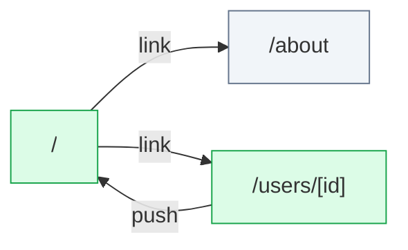

# basic: flow map

Generated by flow-checker v0.0.0-test on 2026-10-29 12:00 UTC from a scan of `app` (Next.js 16.4.3).

> Captured requests in these docs are redacted: passwords, tokens and other sensitive values are masked.

## Summary

|  | Count |
| --- | ---: |
| Pages | 3 |
| Route handlers | 0 |
| Components | 7 |
| Requests | 4 |
| Endpoints | [4](endpoints.md) |
| Flows | 1 |
| Types | 6 |

## Verification

- **4 of 4 requests verified** by live capture (100%).
- 7 captures: 7 matched, 0 ambiguous, 0 unmatched.
- Flows: 0 confirmed, 0 partly walked, 1 not walked yet.

[1 open issue](issues.md). [All types](types.md).

## Route map

Green: every request verified. Red: a type mismatch. Amber: needs a re-check. Grey: not verified yet. Dotted: calls a route handler.

## Pages

| Page | File | Requests | Status |
| --- | --- | --- | --- |
| [`/`](pages/index.md) | `app/page.tsx` | 1 | ✓ 1 verified |
| [`/about`](pages/about.md) | `app/(marketing)/about/page.tsx` | 0 | — |
| [`/users/[id]`](pages/users.%5Bid%5D.md) | `app/users/[id]/page.tsx` | 3 | ✓ 3 verified |

## Backends

| Host | Endpoints | Called from the browser |
| --- | ---: | ---: |
| [`{NEXT_PUBLIC_API_URL ?? http://localhost:4010}`](endpoints.md#host-env_NEXT_PUBLIC_API_URL) | 4 | 2 |

## Flows

| Flow | Pages | Status |
| --- | --- | --- |
| [DeleteUserButton click](flows/deleteuserbutton-click.md) | `/users/[id]` → `/` | not walked yet |

## Components

| Component | Kind | File | Requests |
| --- | --- | --- | --- |
| [`AboutPage`](components/AboutPage.md) | server | `app/(marketing)/about/page.tsx:2` | 0 |
| [`RootLayout`](components/RootLayout.md) | server | `app/layout.tsx:6` | 0 |
| [`HomePage`](components/HomePage.md) | server | `app/page.tsx:7` | 1 |
| [`UserPage`](components/UserPage.md) | server | `app/users/[id]/page.tsx:8` | 1 |
| [`DeleteUserButton`](components/DeleteUserButton.md) | client | `components/DeleteUserButton.tsx:12` | 1 |
| [`ProfileCard`](components/ProfileCard.md) | client | `components/ProfileCard.tsx:12` | 1 |
| [`UserList`](components/UserList.md) | server | `components/UserList.tsx:9` | 0 |
