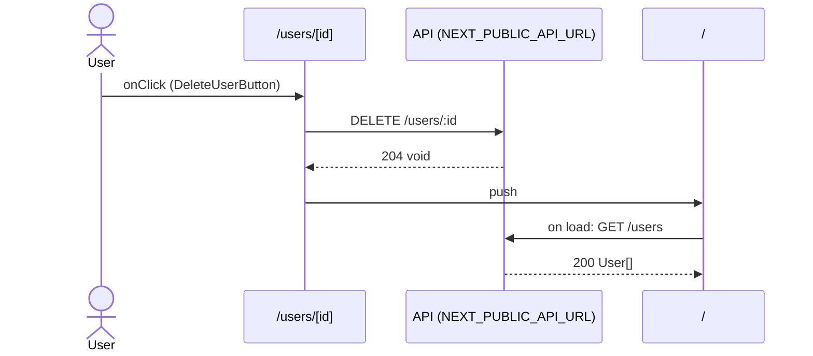

# Flow: DeleteUserButton click

[← Overview](../README.md)

|  |  |
| --- | --- |
| Starts | [`DeleteUserButton`](../components/DeleteUserButton.md) on [`/users/[id]`](../pages/users.%5Bid%5D.md) |
| Pages | [`/users/[id]`](../pages/users.%5Bid%5D.md) → [`/`](../pages/index.md) |
| Status | not walked yet |

## Sequence



## Steps

| # | Step | Detail |
| ---: | --- | --- |
| 1 | User `onClick` in [`DeleteUserButton`](../components/DeleteUserButton.md) on [`/users/[id]`](../pages/users.%5Bid%5D.md) | `components/DeleteUserButton.tsx:27` |
| 2 | [`DELETE {NEXT_PUBLIC_API_URL ?? http://localhost:4010}/users/:id`](#req_0l0l4hns6qh) | response `void` · ✓ verified (1 capture) |
| 3 | push → [`/`](../pages/index.md) | on success · `components/DeleteUserButton.tsx:19` |
| 4 | Page loads: [`GET {NEXT_PUBLIC_API_URL ?? http://localhost:4010}/users`](#req_23wds4ry0if) | response `User[]` · ✓ verified (3 captures) |

## Requests

### <a id="req_0l0l4hns6qh"></a>`DELETE {NEXT_PUBLIC_API_URL ?? http://localhost:4010}/users/:id`

|  |  |
| --- | --- |
| Status | ✓ verified (1 capture) |
| From | [`DeleteUserButton`](../components/DeleteUserButton.md) · `components/DeleteUserButton.tsx:18` |
| Trigger | event onClick |
| Transport | axios |
| URL | `{NEXT_PUBLIC_API_URL ?? http://localhost:4010}/users/:id` (pattern) |
| Call path | `deleteUser` → `api.delete` |

**Response** `void`

**Captured** `DELETE http://localhost:4010/users/2` → 204 No Content · 21 ms · 2026-10-28 10:56 UTC · page `/users/2`

### <a id="req_23wds4ry0if"></a>`GET {NEXT_PUBLIC_API_URL ?? http://localhost:4010}/users`

|  |  |
| --- | --- |
| Status | ✓ verified (3 captures) |
| From | [`HomePage`](../components/HomePage.md) · `app/page.tsx:8` |
| Trigger | server-render |
| Transport | fetch |
| URL | `{NEXT_PUBLIC_API_URL ?? http://localhost:4010}/users` |
| Call path | `getUsers` → `fetch` |

**Response** `User[]` (see [`User`](../types.md#typ_0857a9l1j3p))

**Captured** `GET http://localhost:4010/users` → 200 OK · 16 ms · 2026-10-28 10:56 UTC (newest of 3)

Response body:

```json
[
  {
    "id": 1,
    "name": "Ada Lovelace",
    "email": "ada@example.com",
    "role": "admin"
  }
]
```
