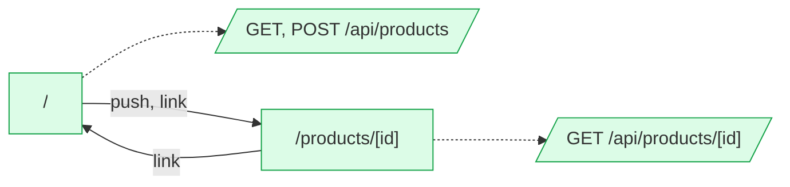

# bff: flow map

Generated by flow-checker v0.0.0-test on 2026-10-29 12:00 UTC from a scan of `src/app` (Next.js 16.4.3).

> Captured requests in these docs are redacted: passwords, tokens and other sensitive values are masked.

## Summary

|  | Count |
| --- | ---: |
| Pages | 2 |
| Areas | [2](areas.md) |
| Route handlers | 2 |
| Components | 5 |
| Requests | 6 |
| Endpoints | [6](endpoints.md) |
| Flows | 1 |
| Types | 3 |

## Verification

- **6 of 6 requests verified** by live capture (100%).
- 10 captures: 10 matched, 0 ambiguous, 0 unmatched.
- Flows: 0 confirmed, 0 partly walked, 1 not walked yet.

[1 open issue](issues.md). [All types](types.md).

## Route map

Green: every request verified. Red: a type mismatch. Amber: needs a re-check. Grey: not verified yet. Dotted: calls a route handler.

## Pages

| Page | File | Access | Requests | Status |
| --- | --- | --- | --- | --- |
| [`/`](pages/index.md) | `src/app/page.tsx` | open | 2 | ✓ 2 verified |
| [`/products/[id]`](pages/products.%5Bid%5D.md) | `src/app/products/[id]/page.tsx` | open | 1 | ✓ 1 verified |

## Areas

| Area | Pages | Flows | Endpoints |
| --- | ---: | ---: | ---: |
| [home](areas.md#ar_1vn39fso9m3) | 1 | 1 | 4 |
| [products](areas.md#ar_2erkuzrjb5u) | 1 | 0 | 2 |

## Route handlers

| Route | Methods | File | Requests it sends |
| --- | --- | --- | --- |
| [`/api/products`](pages/api.products.md) | GET, POST | `src/app/api/products/route.ts` | 2 |
| [`/api/products/[id]`](pages/api.products.%5Bid%5D.md) | GET | `src/app/api/products/[id]/route.ts` | 1 |

## Backends

| Host | Endpoints | Called from the browser |
| --- | ---: | ---: |
| [This app's API](endpoints.md#host-app) | 3 | 3 |
| [`{BACKEND_URL ?? http://localhost:4010}`](endpoints.md#host-env_BACKEND_URL) | 3 | 0 |

## Flows

| Flow | Pages | Status |
| --- | --- | --- |
| [CreateProductForm submit](flows/createproductform-submit.md) | `/` → `/products/[id]` | not walked yet |

## Components

| Component | Kind | File | Requests |
| --- | --- | --- | --- |
| [`RootLayout`](components/RootLayout.md) | server | `src/app/layout.tsx:5` | 0 |
| [`HomePage`](components/HomePage.md) | server | `src/app/page.tsx:4` | 0 |
| [`ProductPage`](components/ProductPage.md) | client | `src/app/products/[id]/page.tsx:8` | 1 |
| [`CreateProductForm`](components/CreateProductForm.md) | client | `src/components/CreateProductForm.tsx:8` | 1 |
| [`ProductsTable`](components/ProductsTable.md) | client | `src/components/ProductsTable.tsx:8` | 1 |
