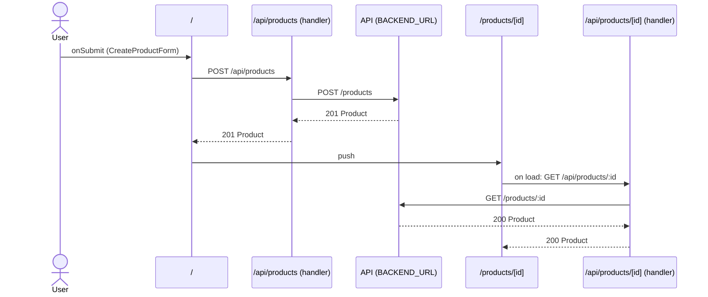

# Flow: CreateProductForm submit

[← Overview](../README.md)

|  |  |
| --- | --- |
| Starts | [`CreateProductForm`](../components/CreateProductForm.md) on [`/`](../pages/index.md) |
| Pages | [`/`](../pages/index.md) → [`/products/[id]`](../pages/products.%5Bid%5D.md) |
| Status | not walked yet |

## Sequence



## Steps

| # | Step | Detail |
| ---: | --- | --- |
| 1 | User `onSubmit` in [`CreateProductForm`](../components/CreateProductForm.md) on [`/`](../pages/index.md) | `src/components/CreateProductForm.tsx:36` |
| 2 | [`POST /api/products`](#req_2ckm3fl20ym) | body `CreateProductInput` · response `Product` · ✓ verified (1 capture) |
| 3 | push → [`/products/[id]`](../pages/products.%5Bid%5D.md) | on success · `src/components/CreateProductForm.tsx:29` |
| 4 | Page loads: [`GET /api/products/:id`](#req_2c3yq1l5klb) | response `Product` · ✓ verified (2 captures) |

## Requests

### <a id="req_2ckm3fl20ym"></a>`POST /api/products`

|  |  |
| --- | --- |
| Status | ✓ verified (1 capture) |
| From | [`CreateProductForm`](../components/CreateProductForm.md) · `src/components/CreateProductForm.tsx:21` |
| Trigger | event onSubmit |
| Transport | fetch |
| URL | `/api/products` |
| Handled by | [`/api/products`](../pages/api.products.md) |

**Request body** [`CreateProductInput`](../types.md#typ_2g53pdr4pws)

```ts
{ name: string; price: number; stock?: number }
```

**Response** [`Product`](../types.md#typ_1rwhmsgdwtz)

```ts
{ id: number; name: string; price: number; stock: number }
```

**Captured** `POST http://localhost:3077/api/products` → 201 Created · 41 ms · 2026-10-28 10:57 UTC · page `/`

Request body:

```json
{
  "name": "Cable",
  "price": 9.5,
  "stock": 3
}
```

Response body:

```json
{
  "id": 3,
  "stock": 3,
  "name": "Cable",
  "price": 9.5
}
```

**Leads to** `POST {BACKEND_URL ?? http://localhost:4010}/products`:

#### <a id="req_02nrpzzew80"></a>`POST {BACKEND_URL ?? http://localhost:4010}/products`

|  |  |
| --- | --- |
| Status | ✓ verified (1 capture) |
| From | POST [`/api/products`](../pages/api.products.md) · `src/app/api/products/route.ts:23` |
| Trigger | route-handler |
| Transport | fetch |
| URL | `{BACKEND_URL ?? http://localhost:4010}/products` |
| Call path | `backend` → `fetch` |

**Request body** `{ name: string; price: number; stock: number; }`

```ts
{ name: string; price: number; stock: number }
```

**Response** [`Product`](../types.md#typ_1rwhmsgdwtz)

```ts
{ id: number; name: string; price: number; stock: number }
```

**Captured** `POST http://localhost:4010/products` → 201 Created · 8 ms · 2026-10-28 10:57 UTC

Request body:

```json
{
  "name": "Cable",
  "price": 9.5,
  "stock": 3
}
```

Response body:

```json
{
  "id": 3,
  "stock": 3,
  "name": "Cable",
  "price": 9.5
}
```

### <a id="req_2c3yq1l5klb"></a>`GET /api/products/:id`

|  |  |
| --- | --- |
| Status | ✓ verified (2 captures) |
| From | [`ProductPage`](../components/ProductPage.md) · `src/app/products/[id]/page.tsx:13` |
| Trigger | effect |
| Transport | fetch |
| URL | `/api/products/:id` (pattern) |
| Handled by | [`/api/products/[id]`](../pages/api.products.%5Bid%5D.md) |

**Response** [`Product`](../types.md#typ_1rwhmsgdwtz)

```ts
{ id: number; name: string; price: number; stock: number }
```

**Captured** `GET http://localhost:3077/api/products/3` → 200 OK · 1499 ms · 2026-10-28 10:57 UTC · page `/products/3` (newest of 2)

Response body:

```json
{
  "id": 3,
  "stock": 3,
  "name": "Cable",
  "price": 9.5
}
```

**Leads to** `GET {BACKEND_URL ?? http://localhost:4010}/products/:id`:

#### <a id="req_1t6ibh8o0so"></a>`GET {BACKEND_URL ?? http://localhost:4010}/products/:id`

|  |  |
| --- | --- |
| Status | ✓ verified (2 captures) |
| From | GET [`/api/products/[id]`](../pages/api.products.%5Bid%5D.md) · `src/app/api/products/[id]/route.ts:8` |
| Trigger | route-handler |
| Transport | fetch |
| URL | `{BACKEND_URL ?? http://localhost:4010}/products/:id` (pattern) |
| Call path | `backend` → `fetch` |

**Response** [`Product`](../types.md#typ_1rwhmsgdwtz)

```ts
{ id: number; name: string; price: number; stock: number }
```

**Captured** `GET http://localhost:4010/products/3` → 200 OK · 3 ms · 2026-10-28 10:57 UTC (newest of 2)

Response body:

```json
{
  "id": 3,
  "stock": 3,
  "name": "Cable",
  "price": 9.5
}
```
