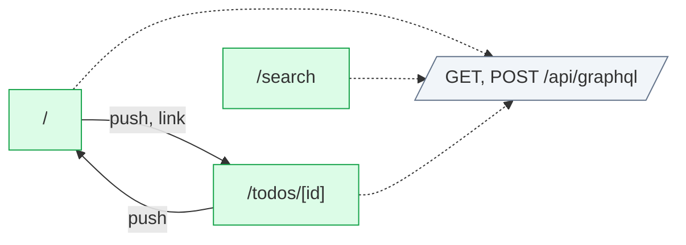

# graphql-apollo-v3: flow map

New to this app? [Start here](ONBOARDING.md) for a short tour.

Generated by flow-checker v0.0.0-test on 2026-10-29 12:00 UTC from a scan of `src/app` (Next.js 16.4.3).

> Captured requests in these docs are redacted: passwords, tokens and other sensitive values are masked.

## Summary

|  | Count |
| --- | ---: |
| Pages | 3 |
| Areas | [3](areas.md) |
| Route handlers | 1 |
| Components | 10 |
| Requests | 6 |
| Endpoints | [6](endpoints.md) |
| Flows | 3 |
| Types | 13 |

## Verification

- **6 of 6 requests verified** by live capture (100%).
- 14 captures: 14 matched, 0 ambiguous, 0 unmatched.
- Flows: 0 confirmed, 0 partly walked, 3 not walked yet.

[3 open issues](issues.md). [All types](types.md).

## Route map

Green: every request verified. Red: a type mismatch. Amber: needs a re-check. Grey: not verified yet. Dotted: calls a route handler.

## Pages

| Page | File | Access | Requests | Status |
| --- | --- | --- | --- | --- |
| [`/`](pages/index.md) | `src/app/page.tsx` | open | 3 | ✓ 3 verified |
| [`/search`](pages/search.md) | `src/app/search/page.tsx` | open | 1 | ✓ 1 verified |
| [`/todos/[id]`](pages/todos.%5Bid%5D.md) | `src/app/todos/[id]/page.tsx` | open | 2 | ✓ 2 verified |

## Areas

| Area | Pages | Flows | Endpoints |
| --- | ---: | ---: | ---: |
| [home](areas.md#ar_1vn39fso9m3) | 1 | 1 | 3 |
| [search](areas.md#ar_1d3830wqgab) | 1 | 1 | 1 |
| [todos](areas.md#ar_1zap1ick15k) | 1 | 1 | 2 |

## Route handlers

| Route | Methods | File | Requests it sends |
| --- | --- | --- | --- |
| [`/api/graphql`](pages/api.graphql.md) | GET, POST | `src/app/api/graphql/route.ts` | 0 |

## Backends

| Host | Endpoints | Called from the browser |
| --- | ---: | ---: |
| [This app's API](endpoints.md#host-app) | 6 | 6 |

## GraphQL

[`/api/graphql`](graphql.md): 6 of 6 operations sent by the app.

## Flows

| Flow | Pages | Status |
| --- | --- | --- |
| [AddTodoForm submit](flows/addtodoform-submit.md) | `/` → `/todos/[id]` | not walked yet |
| [Search submit](flows/search-submit.md) | `/search` | not walked yet |
| [TodoDetail click](flows/tododetail-click.md) | `/todos/[id]` → `/` | not walked yet |

## Components

| Component | Kind | File | Requests |
| --- | --- | --- | --- |
| [`RootLayout`](components/RootLayout.md) | server | `src/app/layout.tsx:6` | 0 |
| [`HomePage`](components/HomePage.md) | server | `src/app/page.tsx:5` | 0 |
| [`Providers`](components/Providers.md) | client | `src/app/providers.tsx:7` | 0 |
| [`SearchPage`](components/SearchPage.md) | server | `src/app/search/page.tsx:3` | 0 |
| [`TodoPage`](components/TodoPage.md) | server | `src/app/todos/[id]/page.tsx:3` | 0 |
| [`AddTodoForm`](components/AddTodoForm.md) | client | `src/components/AddTodoForm.tsx:9` | 1 |
| [`Search`](components/Search.md) | client | `src/components/Search.tsx:8` | 1 |
| [`TodoDetail`](components/TodoDetail.md) | client | `src/components/TodoDetail.tsx:8` | 2 |
| [`TodoList`](components/TodoList.md) | client | `src/components/TodoList.tsx:8` | 1 |
| [`ViewerBadge`](components/ViewerBadge.md) | client | `src/components/ViewerBadge.tsx:7` | 1 |
