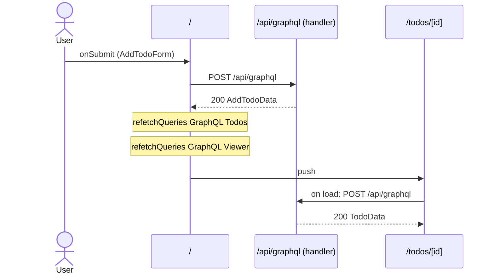

# Flow: AddTodoForm submit

[← Overview](../README.md)

|  |  |
| --- | --- |
| Starts | [`AddTodoForm`](../components/AddTodoForm.md) on [`/`](../pages/index.md) |
| Pages | [`/`](../pages/index.md) → [`/todos/[id]`](../pages/todos.%5Bid%5D.md) |
| Status | not walked yet |

## Sequence



## Steps

| # | Step | Detail |
| ---: | --- | --- |
| 1 | User `onSubmit` in [`AddTodoForm`](../components/AddTodoForm.md) on [`/`](../pages/index.md) | `src/components/AddTodoForm.tsx:23` |
| 2 | [`POST /api/graphql`](#req_1vvhclt0a1p) | body `AddTodoVars` · response `AddTodoData` · ✓ verified (2 captures) |
| 3 | `refetchQueries` `GraphQL Todos` | refetches `POST /api/graphql` · `src/components/AddTodoForm.tsx:13` |
| 4 | `refetchQueries` `GraphQL Viewer` | refetches `POST /api/graphql` · `src/components/AddTodoForm.tsx:13` |
| 5 | push → [`/todos/[id]`](../pages/todos.%5Bid%5D.md) | on success · `src/components/AddTodoForm.tsx:19` |
| 6 | Page loads: [`POST /api/graphql`](#req_1pbvj0u5igd) | body `TodoVars` · response `TodoData` · ✓ verified (2 captures) |

## Requests

### <a id="req_1vvhclt0a1p"></a>`POST /api/graphql`

|  |  |
| --- | --- |
| Status | ✓ verified (2 captures) |
| From | [`AddTodoForm`](../components/AddTodoForm.md) · `src/components/AddTodoForm.tsx:12` |
| Trigger | event onSubmit |
| Transport | graphql · `useMutation` |
| URL | `/api/graphql` |
| GraphQL | [`AddTodo`](../graphql.md#operation-AddTodo) (mutation) |
| Handled by | [`/api/graphql`](../pages/api.graphql.md) |

**Request body** [`AddTodoVars`](../types.md#typ_1bkwuejlfje)

```ts
{ input: { title: string; ownerId?: string } }
```

**Response** [`AddTodoData`](../types.md#typ_0wlmt9r8y2s)

```ts
{ addTodo: TodoFields }
```

**Captured** `POST http://localhost:3077/api/graphql` → 200 OK · 23 ms · 2026-10-30 10:33 UTC · page `/` (newest of 2)

Request body:

```json
{
  "operationName": "AddTodo",
  "variables": {
    "input": {
      "title": "Record captures"
    }
  },
  "extensions": {
    "persistedQuery": {
      "version": 1,
      "sha256Hash": "3f1819d16ee54d56e45ae7998635162e64d71eb45a18c10421f47aed72e9e02e"
    }
  },
  "query": "mutation AddTodo($input: AddTodoInput!) {\n  addTodo(input: $input) {\n    ...TodoFields\n    __typename\n  }\n}\n\nfragment TodoFields on Todo {\n  id\n  title\n  done\n  __typename\n}"
}
```

Response body:

```json
{
  "data": {
    "addTodo": {
      "id": "4",
      "title": "Record captures",
      "done": false,
      "__typename": "Todo"
    }
  }
}
```

### <a id="req_1pbvj0u5igd"></a>`POST /api/graphql`

|  |  |
| --- | --- |
| Status | ✓ verified (2 captures) |
| From | [`TodoDetail`](../components/TodoDetail.md) · `src/components/TodoDetail.tsx:10` |
| Trigger | page-load |
| Transport | graphql · `useQuery` |
| URL | `/api/graphql` |
| GraphQL | [`Todo`](../graphql.md#operation-Todo) (query) |
| Handled by | [`/api/graphql`](../pages/api.graphql.md) |

**Request body** [`TodoVars`](../types.md#typ_1fpq9nx1vnr)

```ts
{ id: string }
```

**Response** [`TodoData`](../types.md#typ_255hzpa6ygn)

```ts
{ todo: TodoDetailFields | null }
```

**Captured** `POST http://localhost:3077/api/graphql` → 200 OK · 48 ms · 2026-10-30 10:33 UTC · page `/todos/4` (newest of 2)

Request body:

```json
{
  "operationName": "Todo",
  "variables": {
    "id": "4"
  },
  "extensions": {
    "persistedQuery": {
      "version": 1,
      "sha256Hash": "0e09449f79c9be377ed88e00b678e281364eebfbe732f99daa5b3f2b049f76bd"
    }
  },
  "query": "query Todo($id: ID!) {\n  todo(id: $id) {\n    ...TodoFields\n    status\n    owner {\n      id\n      name\n      __typename\n    }\n    __typename\n  }\n}\n\nfragment TodoFields on Todo {\n  id\n  title\n  done\n  __typename\n}"
}
```

Response body:

```json
{
  "data": {
    "todo": {
      "id": "4",
      "title": "Record captures",
      "done": false,
      "__typename": "Todo",
      "status": "OPEN",
      "owner": {
        "id": "u1",
        "name": "Ada Lovelace",
        "__typename": "User"
      }
    }
  }
}
```
