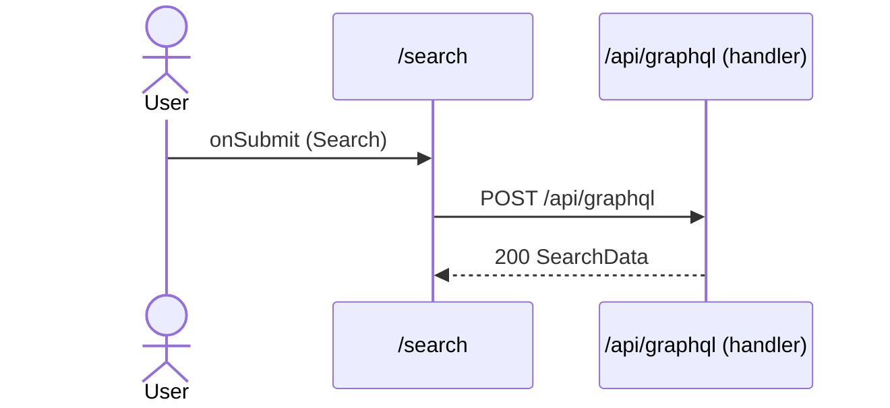

# Flow: Search submit

[← Overview](../README.md)

|  |  |
| --- | --- |
| Starts | [`Search`](../components/Search.md) on [`/search`](../pages/search.md) |
| Pages | [`/search`](../pages/search.md) |
| Status | not walked yet |

## Sequence



## Steps

| # | Step | Detail |
| ---: | --- | --- |
| 1 | User `onSubmit` in [`Search`](../components/Search.md) on [`/search`](../pages/search.md) | `src/components/Search.tsx:19` |
| 2 | [`POST /api/graphql`](#req_0k4apzrnh4p) | body `SearchVars` · response `SearchData` · ✓ verified (2 captures) |

## Requests

### <a id="req_0k4apzrnh4p"></a>`POST /api/graphql`

|  |  |
| --- | --- |
| Status | ✓ verified (2 captures) |
| From | [`Search`](../components/Search.md) · `src/components/Search.tsx:10` |
| Trigger | event onSubmit |
| Transport | graphql · `useLazyQuery` |
| URL | `/api/graphql` |
| GraphQL | [`Search`](../graphql.md#operation-Search) (query) |
| Handled by | [`/api/graphql`](../pages/api.graphql.md) |

**Request body** [`SearchVars`](../types.md#typ_1wwzgmtm01j)

```ts
{ text: string }
```

**Response** [`SearchData`](../types.md#typ_23i4ebffrfm)

```ts
{ search: SearchResult[] }
```

**Captured** `POST http://localhost:3077/api/graphql` → 200 OK · 19 ms · 2026-10-30 10:33 UTC · page `/search` (newest of 2)

Request body:

```json
{
  "operationName": "Search",
  "variables": {
    "text": "a"
  },
  "extensions": {
    "persistedQuery": {
      "version": 1,
      "sha256Hash": "15029ee6b1a77fa90e113d273aec5c628882e954a85592be3fd3b065887fa4e7"
    }
  },
  "query": "query Search($text: String!) {\n  search(text: $text) {\n    __typename\n    ... on Todo {\n      id\n      title\n      __typename\n    }\n    ... on User {\n      id\n      name\n      __typename\n    }\n  }\n}"
}
```

Response body:

```json
{
  "data": {
    "search": [
      {
        "__typename": "Todo",
        "id": "1",
        "title": "Write the schema"
      },
      {
        "__typename": "Todo",
        "id": "2",
        "title": "Add a route handler"
      },
      {
        "__typename": "Todo",
        "id": "3",
        "title": "Try a persisted query"
      },
      {
        "__typename": "User",
        "id": "u1",
        "name": "Ada Lovelace"
      },
      {
        "__typename": "User",
        "id": "u2",
        "name": "Grace Hopper"
      },
      {
        "__typename": "User",
        "id": "u3",
        "name": "Alan Turing"
      }
    ]
  }
}
```
