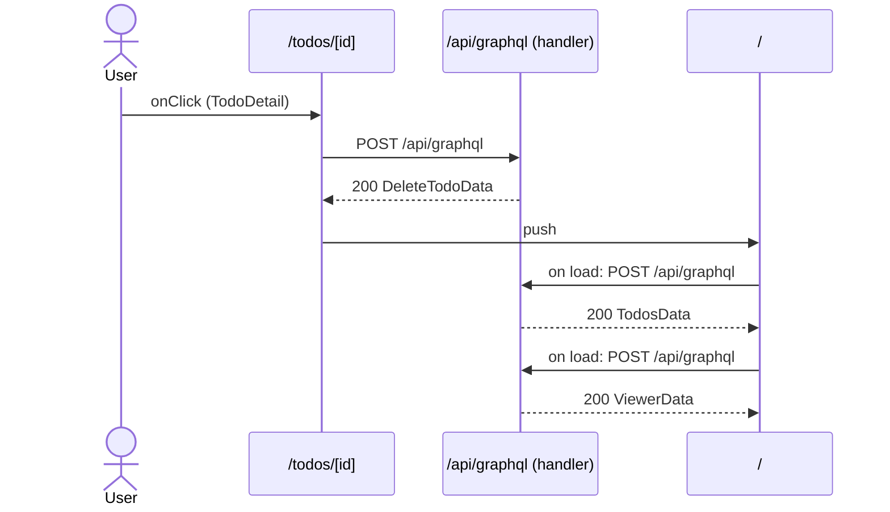

# Flow: TodoDetail click

[← Overview](../README.md)

|  |  |
| --- | --- |
| Starts | [`TodoDetail`](../components/TodoDetail.md) on [`/todos/[id]`](../pages/todos.%5Bid%5D.md) |
| Pages | [`/todos/[id]`](../pages/todos.%5Bid%5D.md) → [`/`](../pages/index.md) |
| Status | not walked yet |

## Sequence



## Steps

| # | Step | Detail |
| ---: | --- | --- |
| 1 | User `onClick` in [`TodoDetail`](../components/TodoDetail.md) on [`/todos/[id]`](../pages/todos.%5Bid%5D.md) | `src/components/TodoDetail.tsx:22` |
| 2 | [`POST /api/graphql`](#req_16r77ymnxz7) | body `TodoVars` · response `DeleteTodoData` · ✓ verified (2 captures) |
| 3 | push → [`/`](../pages/index.md) | on success · `src/components/TodoDetail.tsx:12` |
| 4 | Page loads: [`POST /api/graphql`](#req_0tco1ayy7vx) | response `TodosData` · ✓ verified (3 captures) |
| 5 | Page loads: [`POST /api/graphql`](#req_0zshh8iwl6e) | response `ViewerData` · ✓ verified (3 captures) |

## Requests

### <a id="req_16r77ymnxz7"></a>`POST /api/graphql`

|  |  |
| --- | --- |
| Status | ✓ verified (2 captures) |
| From | [`TodoDetail`](../components/TodoDetail.md) · `src/components/TodoDetail.tsx:11` |
| Trigger | event onClick |
| Transport | graphql · `useMutation` |
| URL | `/api/graphql` |
| GraphQL | [`DeleteTodo`](../graphql.md#operation-DeleteTodo) (mutation) |
| Handled by | [`/api/graphql`](../pages/api.graphql.md) |

**Request body** [`TodoVars`](../types.md#typ_1fpq9nx1vnr)

```ts
{ id: string }
```

**Response** [`DeleteTodoData`](../types.md#typ_23z70ad4x4v)

```ts
{ deleteTodo: boolean }
```

**Captured** `POST http://localhost:3077/api/graphql` → 200 OK · 19 ms · 2026-10-30 10:33 UTC · page `/todos/4` (newest of 2)

Request body:

```json
{
  "operationName": "DeleteTodo",
  "variables": {
    "id": "4"
  },
  "extensions": {
    "persistedQuery": {
      "version": 1,
      "sha256Hash": "df3507b3704816b720732c21aad5660fc53324e32318046d72fc0096ec7bc27f"
    }
  },
  "query": "mutation DeleteTodo($id: ID!) {\n  deleteTodo(id: $id)\n}"
}
```

Response body:

```json
{
  "data": {
    "deleteTodo": true
  }
}
```

### <a id="req_0tco1ayy7vx"></a>`POST /api/graphql`

|  |  |
| --- | --- |
| Status | ✓ verified (3 captures) |
| From | [`TodoList`](../components/TodoList.md) · `src/components/TodoList.tsx:9` |
| Trigger | page-load |
| Transport | graphql · `useQuery` |
| URL | `/api/graphql` |
| GraphQL | [`Todos`](../graphql.md#operation-Todos) (query) |
| Handled by | [`/api/graphql`](../pages/api.graphql.md) |

**Response** [`TodosData`](../types.md#typ_1qf74f1isvg)

```ts
{ todos: TodoFields[] }
```

**Captured** `POST http://localhost:3077/api/graphql` → 200 OK · 35 ms · 2026-10-30 10:33 UTC · page `/` (newest of 3)

Request body:

```json
{
  "operationName": "Todos",
  "variables": {},
  "extensions": {
    "persistedQuery": {
      "version": 1,
      "sha256Hash": "01222f14ad0e3236e408a6372a7a1d8249955ac5cef1542d8f53b55ed9b94911"
    }
  }
}
```

Response body:

```json
{
  "data": {
    "todos": [
      {
        "id": "1",
        "title": "Write the schema",
        "done": true,
        "__typename": "Todo"
      },
      {
        "id": "2",
        "title": "Add a route handler",
        "done": false,
        "__typename": "Todo"
      },
      {
        "id": "3",
        "title": "Try a persisted query",
        "done": false,
        "__typename": "Todo"
      },
      {
        "id": "4",
        "title": "Record captures",
        "done": false,
        "__typename": "Todo"
      }
    ]
  }
}
```

### <a id="req_0zshh8iwl6e"></a>`POST /api/graphql`

|  |  |
| --- | --- |
| Status | ✓ verified (3 captures) |
| From | [`ViewerBadge`](../components/ViewerBadge.md) · `src/components/ViewerBadge.tsx:8` |
| Trigger | page-load |
| Transport | graphql · `useQuery` |
| URL | `/api/graphql` |
| GraphQL | [`Viewer`](../graphql.md#operation-Viewer) (query) |
| Handled by | [`/api/graphql`](../pages/api.graphql.md) |

**Response** [`ViewerData`](../types.md#typ_1y0i7pm0ntp)

```ts
{ viewer: User }
```

**Captured** `POST http://localhost:3077/api/graphql` → 200 OK · 23 ms · 2026-10-30 10:33 UTC · page `/` (newest of 3)

Request body:

```json
{
  "operationName": "Viewer",
  "variables": {},
  "extensions": {
    "persistedQuery": {
      "version": 1,
      "sha256Hash": "11989ecb8468c2f61be018171850054bc1968ecc87dd54708dc1b207f7b6cfaf"
    }
  }
}
```

Response body:

```json
{
  "data": {
    "viewer": {
      "id": "u1",
      "name": "Ada Lovelace",
      "email": "ada@example.com",
      "__typename": "User"
    }
  }
}
```
