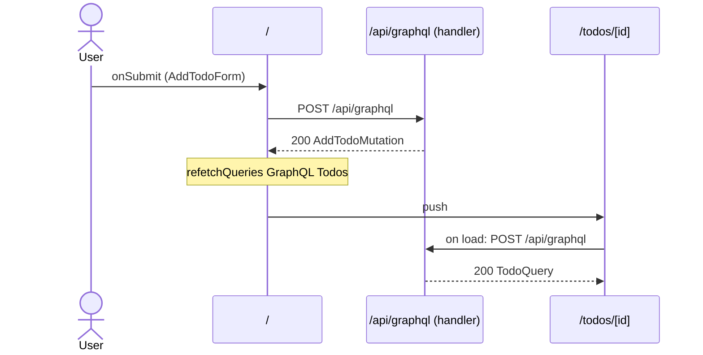

# Flow: AddTodoForm submit

[← Overview](../README.md)

|  |  |
| --- | --- |
| Starts | [`AddTodoForm`](../components/AddTodoForm.md) on [`/`](../pages/index.md) |
| Pages | [`/`](../pages/index.md) → [`/todos/[id]`](../pages/todos.%5Bid%5D.md) |
| Status | not walked yet |

## Sequence



## Steps

| # | Step | Detail |
| ---: | --- | --- |
| 1 | User `onSubmit` in [`AddTodoForm`](../components/AddTodoForm.md) on [`/`](../pages/index.md) | `src/components/AddTodoForm.tsx:31` |
| 2 | [`POST /api/graphql`](#req_1se0zfbjglz) | body `Exact<{ input: AddTodoInput; }>` · response `AddTodoMutation` · ✓ verified (1 capture) |
| 3 | `refetchQueries` `GraphQL Todos` | refetches `POST /api/graphql` · `src/components/AddTodoForm.tsx:21` |
| 4 | push → [`/todos/[id]`](../pages/todos.%5Bid%5D.md) | on success · `src/components/AddTodoForm.tsx:22` |
| 5 | Page loads: [`POST /api/graphql`](#req_0y9v4qo3n8x) | body `Exact<{ id: string \| number; }>` · response `TodoQuery` · ✓ verified (1 capture) |

## Requests

### <a id="req_1se0zfbjglz"></a>`POST /api/graphql`

|  |  |
| --- | --- |
| Status | ✓ verified (1 capture) |
| From | [`AddTodoForm`](../components/AddTodoForm.md) · `src/components/AddTodoForm.tsx:20` |
| Trigger | event onSubmit |
| Transport | graphql · `useMutation` |
| URL | `/api/graphql` |
| GraphQL | [`AddTodo`](../graphql.md#operation-AddTodo) (mutation) |
| Handled by | [`/api/graphql`](../pages/api.graphql.md) |

**Request body** [`Exact<{ input: AddTodoInput; }>`](../types.md#typ_164dkm81jm4)

```ts
{ input: AddTodoInput }
```

**Response** [`AddTodoMutation`](../types.md#typ_16ca9i9k1a7)

```ts
{ addTodo: { id: string; title: string } }
```

**Captured** `POST http://localhost:3077/api/graphql` → 200 · 20 ms · 2026-10-30 10:33 UTC · page `/`

Request body:

```json
{
  "operationName": "AddTodo",
  "variables": {
    "input": {
      "title": "Record captures"
    }
  },
  "extensions": {
    "clientLibrary": {
      "name": "@apollo/client",
      "version": "4.3.5"
    }
  },
  "query": "mutation AddTodo($input: AddTodoInput!) {\n  addTodo(input: $input) {\n    id\n    title\n    __typename\n  }\n}"
}
```

Response body:

```json
{
  "data": {
    "addTodo": {
      "id": "4",
      "title": "Record captures",
      "__typename": "Todo"
    }
  }
}
```

### <a id="req_0y9v4qo3n8x"></a>`POST /api/graphql`

|  |  |
| --- | --- |
| Status | ✓ verified (1 capture) |
| From | [`TodoView`](../components/TodoView.md) · `src/components/TodoDetail.tsx:33` |
| Trigger | page-load |
| Transport | graphql · `useSuspenseQuery` |
| URL | `/api/graphql` |
| GraphQL | [`Todo`](../graphql.md#operation-Todo) (query) |
| Handled by | [`/api/graphql`](../pages/api.graphql.md) |

**Request body** [`Exact<{ id: string | number; }>`](../types.md#typ_0kk3su9xks9)

```ts
{ id: string | number }
```

**Response** [`TodoQuery`](../types.md#typ_18j2vjt684p)

```ts
{
  todo: 
    | {
      id: string
      title: string
      done: boolean
      status: TodoStatus
      owner: { name: string }
    }
    | null
}
```

**Captured** `POST http://localhost:3077/api/graphql` → 200 · 21 ms · 2026-10-30 10:33 UTC · page `/todos/4`

Request body:

```json
{
  "operationName": "Todo",
  "variables": {
    "id": "4"
  },
  "extensions": {
    "clientLibrary": {
      "name": "@apollo/client",
      "version": "4.3.5"
    }
  },
  "query": "query Todo($id: ID!) {\n  todo(id: $id) {\n    id\n    title\n    done\n    status\n    owner {\n      name\n      __typename\n    }\n    __typename\n  }\n}"
}
```

Response body:

```json
{
  "data": {
    "todo": {
      "id": "4",
      "title": "Record captures",
      "done": false,
      "status": "OPEN",
      "owner": {
        "name": "Ada Lovelace",
        "__typename": "User"
      },
      "__typename": "Todo"
    }
  }
}
```
