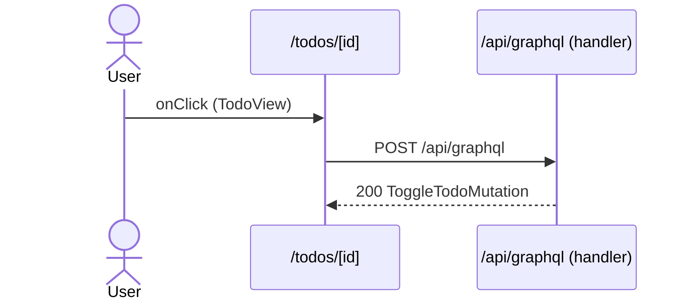

# Flow: TodoView click

[← Overview](../README.md)

|  |  |
| --- | --- |
| Starts | [`TodoView`](../components/TodoView.md) on [`/todos/[id]`](../pages/todos.%5Bid%5D.md) |
| Pages | [`/todos/[id]`](../pages/todos.%5Bid%5D.md) |
| Status | not walked yet |

## Sequence



## Steps

| # | Step | Detail |
| ---: | --- | --- |
| 1 | User `onClick` in [`TodoView`](../components/TodoView.md) on [`/todos/[id]`](../pages/todos.%5Bid%5D.md) | `src/components/TodoDetail.tsx:42` |
| 2 | [`POST /api/graphql`](#req_08vp0aultnf) | body `Exact<{ id: string \| number; }>` · response `ToggleTodoMutation` · ✓ verified (1 capture) |

## Requests

### <a id="req_08vp0aultnf"></a>`POST /api/graphql`

|  |  |
| --- | --- |
| Status | ✓ verified (1 capture) |
| From | [`TodoView`](../components/TodoView.md) · `src/components/TodoDetail.tsx:34` |
| Trigger | event onClick |
| Transport | graphql · `useMutation` |
| URL | `/api/graphql` |
| GraphQL | [`ToggleTodo`](../graphql.md#operation-ToggleTodo) (mutation) |
| Handled by | [`/api/graphql`](../pages/api.graphql.md) |

**Request body** [`Exact<{ id: string | number; }>`](../types.md#typ_0kk3su9xks9)

```ts
{ id: string | number }
```

**Response** [`ToggleTodoMutation`](../types.md#typ_0r3wizusxxi)

```ts
{ toggleTodo: { id: string; done: boolean; status: TodoStatus } }
```

**Captured** `POST http://localhost:3077/api/graphql` → 200 · 20 ms · 2026-10-30 10:33 UTC · page `/todos/4`

Request body:

```json
{
  "operationName": "ToggleTodo",
  "variables": {
    "id": "4"
  },
  "extensions": {
    "clientLibrary": {
      "name": "@apollo/client",
      "version": "4.3.5"
    }
  },
  "query": "mutation ToggleTodo($id: ID!) {\n  toggleTodo(id: $id) {\n    id\n    done\n    status\n    __typename\n  }\n}"
}
```

Response body:

```json
{
  "data": {
    "toggleTodo": {
      "id": "4",
      "done": true,
      "status": "DONE",
      "__typename": "Todo"
    }
  }
}
```
