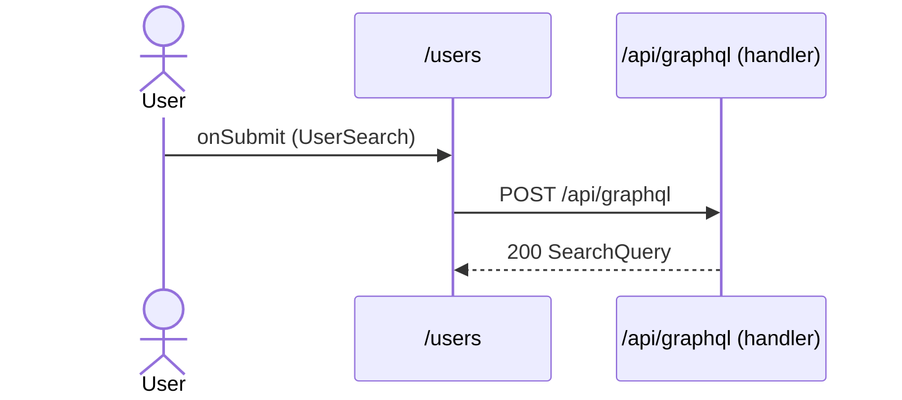

# Flow: UserSearch submit

[← Overview](../README.md)

|  |  |
| --- | --- |
| Starts | [`UserSearch`](../components/UserSearch.md) on [`/users`](../pages/users.md) |
| Pages | [`/users`](../pages/users.md) |
| Status | not walked yet |

## Sequence



## Steps

| # | Step | Detail |
| ---: | --- | --- |
| 1 | User `onSubmit` in [`UserSearch`](../components/UserSearch.md) on [`/users`](../pages/users.md) | `src/components/UserSearch.tsx:52` |
| 2 | [`POST /api/graphql`](#req_27iyr9uuhkz) | body `Exact<{ text: string; }>` · response `SearchQuery` · ✓ verified (1 capture) |

## Requests

### <a id="req_27iyr9uuhkz"></a>`POST /api/graphql`

|  |  |
| --- | --- |
| Status | ✓ verified (1 capture) |
| From | [`UserSearch`](../components/UserSearch.md) · `src/components/UserSearch.tsx:38` |
| Trigger | event onSubmit |
| Transport | graphql · `useLazyQuery` |
| URL | `/api/graphql` |
| GraphQL | [`Search`](../graphql.md#operation-Search) (query) |
| Handled by | [`/api/graphql`](../pages/api.graphql.md) |

**Request body** [`Exact<{ text: string; }>`](../types.md#typ_0rr10bb7h1t)

```ts
{ text: string }
```

**Response** [`SearchQuery`](../types.md#typ_1g0hej3ogvt)

```ts
{
  search: (
    | { __typename: "Todo"; id: string; title: string }
    | { __typename: "User"; id: string; name: string })[]
}
```

**Captured** `POST http://localhost:3077/api/graphql` → 200 · 47 ms · 2026-10-30 10:33 UTC · page `/users`

Request body:

```json
{
  "operationName": "Search",
  "variables": {
    "text": "a"
  },
  "extensions": {
    "clientLibrary": {
      "name": "@apollo/client",
      "version": "4.3.5"
    }
  },
  "query": "query Search($text: String!) {\n  search(text: $text) {\n    __typename\n    ... on Todo {\n      id\n      title\n      __typename\n    }\n    ... on User {\n      id\n      name\n      __typename\n    }\n  }\n}"
}
```

Response body:

```json
{
  "data": {
    "search": [
      {
        "__typename": "Todo",
        "id": "1",
        "title": "Write the schema"
      },
      {
        "__typename": "Todo",
        "id": "2",
        "title": "Add a route handler"
      },
      {
        "__typename": "Todo",
        "id": "3",
        "title": "Try a persisted query"
      },
      {
        "__typename": "Todo",
        "id": "4",
        "title": "Record captures"
      },
      {
        "__typename": "User",
        "id": "u1",
        "name": "Ada Lovelace"
      },
      {
        "__typename": "User",
        "id": "u2",
        "name": "Grace Hopper"
      },
      {
        "__typename": "User",
        "id": "u3",
        "name": "Alan Turing"
      }
    ]
  }
… (1 more line)
```
