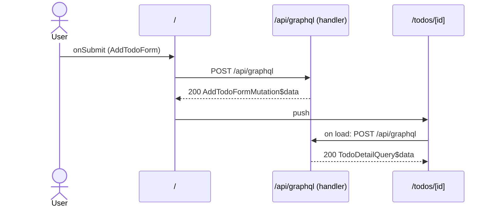

# Flow: AddTodoForm submit

[← Overview](../README.md)

|  |  |
| --- | --- |
| Starts | [`AddTodoForm`](../components/AddTodoForm.md) on [`/`](../pages/index.md) |
| Pages | [`/`](../pages/index.md) → [`/todos/[id]`](../pages/todos.%5Bid%5D.md) |
| Status | not walked yet |

## Sequence



## Steps

| # | Step | Detail |
| ---: | --- | --- |
| 1 | User `onSubmit` in [`AddTodoForm`](../components/AddTodoForm.md) on [`/`](../pages/index.md) | `src/components/AddTodoForm.tsx:29` |
| 2 | [`POST /api/graphql`](#req_25b0dzm9av8) | body `AddTodoFormMutation$variables` · response `AddTodoFormMutation$data` · ✓ verified (1 capture) |
| 3 | push → [`/todos/[id]`](../pages/todos.%5Bid%5D.md) | on success · `src/components/AddTodoForm.tsx:24` |
| 4 | Page loads: [`POST /api/graphql`](#req_0b9cucu4bbq) | body `TodoDetailQuery$variables` · response `TodoDetailQuery$data` · ✓ verified (1 capture) |

## Requests

### <a id="req_25b0dzm9av8"></a>`POST /api/graphql`

|  |  |
| --- | --- |
| Status | ✓ verified (1 capture) |
| From | [`AddTodoForm`](../components/AddTodoForm.md) · `src/components/AddTodoForm.tsx:11` |
| Trigger | event onSubmit |
| Transport | graphql · `useMutation` |
| URL | `/api/graphql` |
| GraphQL | [`AddTodoFormMutation`](../graphql.md#operation-AddTodoFormMutation) (mutation) |
| Handled by | [`/api/graphql`](../pages/api.graphql.md) |

**Request body** [`AddTodoFormMutation$variables`](../types.md#typ_1jk7p5vwxhg)

```ts
{ input: AddTodoInput }
```

**Response** [`AddTodoFormMutation$data`](../types.md#typ_07be3pbscua)

```ts
{ readonly addTodo: { readonly id: string; readonly title: string } }
```

**Captured** `POST http://localhost:3077/api/graphql` → 200 OK · 33 ms · 2026-10-30 10:34 UTC · page `/`

Request body:

```json
{
  "doc_id": "7b287a25c92827de62ee76b0bdbdc3a1f06652f85ea710168f89cd568052bf8d",
  "variables": {
    "input": {
      "title": "Record captures"
    }
  }
}
```

Response body:

```json
{
  "data": {
    "addTodo": {
      "id": "4",
      "title": "Record captures"
    }
  }
}
```

### <a id="req_0b9cucu4bbq"></a>`POST /api/graphql`

|  |  |
| --- | --- |
| Status | ✓ verified (1 capture) |
| From | [`TodoPage`](../components/TodoPage.md) · `src/components/TodoPage.tsx:9` |
| Trigger | effect |
| Transport | graphql · `useQueryLoader` |
| URL | `/api/graphql` |
| GraphQL | [`TodoDetailQuery`](../graphql.md#operation-TodoDetailQuery) (query) |
| Handled by | [`/api/graphql`](../pages/api.graphql.md) |

**Request body** [`TodoDetailQuery$variables`](../types.md#typ_1ji4t5gnvh0)

```ts
{ id: string }
```

**Response** [`TodoDetailQuery$data`](../types.md#typ_1m5qqany6tv)

```ts
{
  readonly todo: 
    | {
      readonly done: boolean
      readonly id: string
      readonly owner: { readonly name: string }
      readonly status: TodoStatus
      readonly title: string
    }
    | null
    | undefined
}
```

**Captured** `POST http://localhost:3077/api/graphql` → 200 OK · 58 ms · 2026-10-30 10:34 UTC · page `/todos/4`

Request body:

```json
{
  "doc_id": "feffca234775cf9b6036b7f757110fbf6f4094f87f75b06bfefb31e31110034d",
  "variables": {
    "id": "4"
  }
}
```

Response body:

```json
{
  "data": {
    "todo": {
      "id": "4",
      "title": "Record captures",
      "done": false,
      "status": "OPEN",
      "owner": {
        "name": "Ada Lovelace",
        "id": "u1"
      }
    }
  }
}
```
