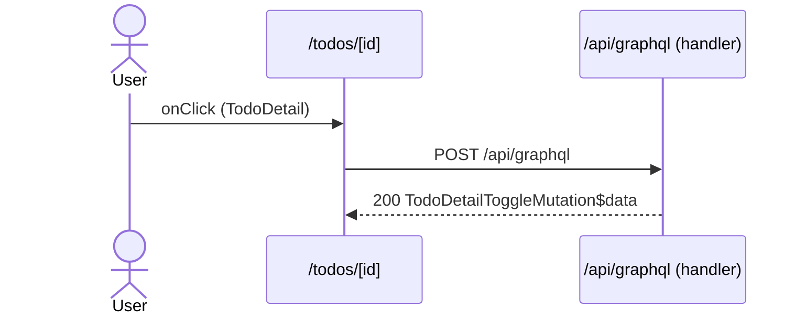

# Flow: TodoDetail click

[← Overview](../README.md)

|  |  |
| --- | --- |
| Starts | [`TodoDetail`](../components/TodoDetail.md) on [`/todos/[id]`](../pages/todos.%5Bid%5D.md) |
| Pages | [`/todos/[id]`](../pages/todos.%5Bid%5D.md) |
| Status | not walked yet |

## Sequence



## Steps

| # | Step | Detail |
| ---: | --- | --- |
| 1 | User `onClick` in [`TodoDetail`](../components/TodoDetail.md) on [`/todos/[id]`](../pages/todos.%5Bid%5D.md) | `src/components/TodoDetail.tsx:52` |
| 2 | [`POST /api/graphql`](#req_0manrbz632m) | body `TodoDetailToggleMutation$variables` · response `TodoDetailToggleMutation$data` · ✓ verified (1 capture) |

## Requests

### <a id="req_0manrbz632m"></a>`POST /api/graphql`

|  |  |
| --- | --- |
| Status | ✓ verified (1 capture) |
| From | [`TodoDetail`](../components/TodoDetail.md) · `src/components/TodoDetail.tsx:32` |
| Trigger | event onClick |
| Transport | graphql · `commitMutation` |
| URL | `/api/graphql` |
| GraphQL | [`TodoDetailToggleMutation`](../graphql.md#operation-TodoDetailToggleMutation) (mutation) |
| Handled by | [`/api/graphql`](../pages/api.graphql.md) |

**Request body** [`TodoDetailToggleMutation$variables`](../types.md#typ_0rtunk5nqpl)

```ts
{ id: string }
```

**Response** [`TodoDetailToggleMutation$data`](../types.md#typ_269jvnd7qf5)

```ts
{ readonly toggleTodo: { readonly done: boolean; readonly id: string } }
```

**Captured** `POST http://localhost:3077/api/graphql` → 200 OK · 24 ms · 2026-10-30 10:35 UTC · page `/todos/4`

Request body:

```json
{
  "doc_id": "ca3885e07dab7aa341848f8d0138896377bf5af08ce9e5106c59714b07e26adf",
  "variables": {
    "id": "4"
  }
}
```

Response body:

```json
{
  "data": {
    "toggleTodo": {
      "id": "4",
      "done": true
    }
  }
}
```
