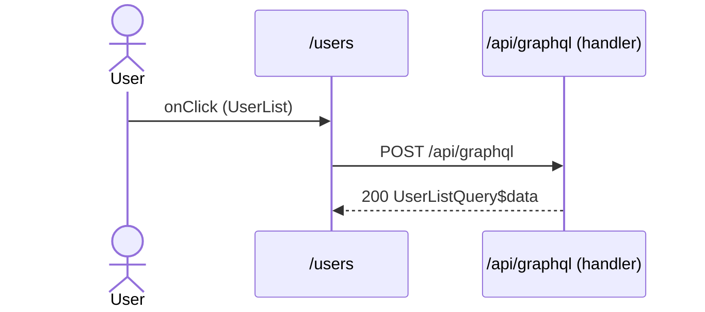

# Flow: UserList click

[← Overview](../README.md)

|  |  |
| --- | --- |
| Starts | [`UserList`](../components/UserList.md) on [`/users`](../pages/users.md) |
| Pages | [`/users`](../pages/users.md) |
| Status | not walked yet |

## Sequence



## Steps

| # | Step | Detail |
| ---: | --- | --- |
| 1 | User `onClick` in [`UserList`](../components/UserList.md) on [`/users`](../pages/users.md) | `src/components/UserList.tsx:30` |
| 2 | [`POST /api/graphql`](#req_2dy1uuhut7o) | body `UserListQuery$variables` · response `UserListQuery$data` · ✓ verified (1 capture) |

## Requests

### <a id="req_2dy1uuhut7o"></a>`POST /api/graphql`

|  |  |
| --- | --- |
| Status | ✓ verified (1 capture) |
| From | [`UserList`](../components/UserList.md) · `src/components/UserList.tsx:12` |
| Trigger | event onClick |
| Transport | graphql · `fetchQuery` |
| URL | `/api/graphql` |
| GraphQL | [`UserListQuery`](../graphql.md#operation-UserListQuery) (query) |
| Handled by | [`/api/graphql`](../pages/api.graphql.md) |

**Request body** [`UserListQuery$variables`](../types.md#typ_1yt21z5dhfc)

```ts
{ [key: string]: never }
```

**Response** [`UserListQuery$data`](../types.md#typ_1fqrz3yzgfq)

```ts
{
  readonly users: readonly { readonly email: string; readonly id: string; readonly name: string }[]
}
```

**Captured** `POST http://localhost:3077/api/graphql` → 200 OK · 72 ms · 2026-10-30 10:35 UTC · page `/users`

Request body:

```json
{
  "doc_id": "fdcca2996f159e3306fc76535a22a6d4afcfa77d41c15bd60b6bd119a64dbe88",
  "variables": {}
}
```

Response body:

```json
{
  "data": {
    "users": [
      {
        "id": "u1",
        "name": "Ada Lovelace",
        "email": "ada@example.com"
      },
      {
        "id": "u2",
        "name": "Grace Hopper",
        "email": "grace@example.com"
      },
      {
        "id": "u3",
        "name": "Alan Turing",
        "email": "alan@example.com"
      }
    ]
  }
}
```
