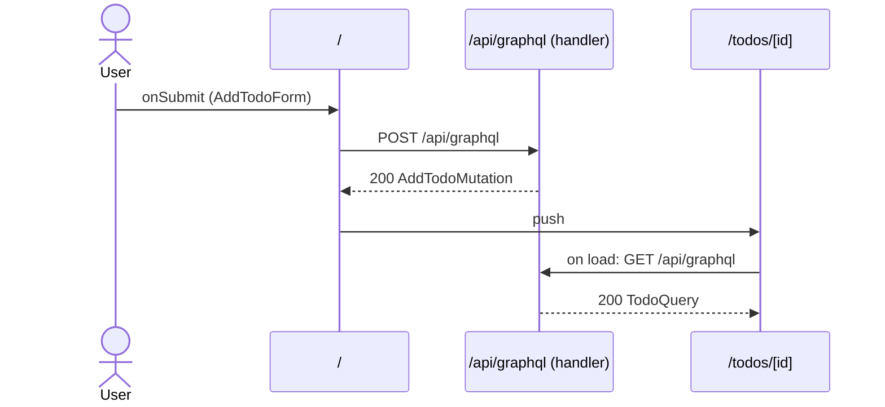

# Flow: AddTodoForm submit

[← Overview](../README.md)

|  |  |
| --- | --- |
| Starts | [`AddTodoForm`](../components/AddTodoForm.md) on [`/`](../pages/index.md) |
| Pages | [`/`](../pages/index.md) → [`/todos/[id]`](../pages/todos.%5Bid%5D.md) |
| Status | not walked yet |

## Sequence



## Steps

| # | Step | Detail |
| ---: | --- | --- |
| 1 | User `onSubmit` in [`AddTodoForm`](../components/AddTodoForm.md) on [`/`](../pages/index.md) | `src/components/AddTodoForm.tsx:29` |
| 2 | [`POST /api/graphql`](#req_1ncc9k5xsh8) | body `AddTodoMutationVariables` · response `AddTodoMutation` · ✓ verified (1 capture) |
| 3 | push → [`/todos/[id]`](../pages/todos.%5Bid%5D.md) | on success · `src/components/AddTodoForm.tsx:24` |
| 4 | Page loads: [`GET /api/graphql`](#req_13zx8cl90id) | body `TodoQueryVariables` · response `TodoQuery` · ✓ verified (2 captures) |

## Requests

### <a id="req_1ncc9k5xsh8"></a>`POST /api/graphql`

|  |  |
| --- | --- |
| Status | ✓ verified (1 capture) |
| From | [`AddTodoForm`](../components/AddTodoForm.md) · `src/components/AddTodoForm.tsx:19` |
| Trigger | event onSubmit |
| Transport | graphql · `useMutation` |
| URL | `/api/graphql` |
| GraphQL | [`AddTodo`](../graphql.md#operation-AddTodo) (mutation) |
| Handled by | [`/api/graphql`](../pages/api.graphql.md) |

**Request body** `AddTodoMutationVariables`

```ts
{ input: { title: string; ownerId?: string | null } }
```

**Response** `AddTodoMutation`

```ts
{ addTodo: { id: string; title: string } }
```

**Captured** `POST http://localhost:3077/api/graphql` → 200 OK · 36 ms · 2026-10-30 10:34 UTC · page `/`

Request body:

```json
{
  "operationName": "AddTodo",
  "query": "mutation AddTodo($input: AddTodoInput!) {\n  addTodo(input: $input) {\n    id\n    title\n    __typename\n  }\n}",
  "variables": {
    "input": {
      "title": "Record captures"
    }
  }
}
```

Response body:

```json
{
  "data": {
    "addTodo": {
      "id": "4",
      "title": "Record captures",
      "__typename": "Todo"
    }
  }
}
```

### <a id="req_13zx8cl90id"></a>`GET /api/graphql`

|  |  |
| --- | --- |
| Status | ✓ verified (2 captures) |
| From | [`TodoDetail`](../components/TodoDetail.md) · `src/components/TodoDetail.tsx:31` |
| Trigger | page-load |
| Transport | graphql · `useQuery` |
| URL | `/api/graphql` |
| GraphQL | [`Todo`](../graphql.md#operation-Todo) (query) |
| Handled by | [`/api/graphql`](../pages/api.graphql.md) |

**Request body** `TodoQueryVariables`

```ts
{ id: string }
```

**Response** `TodoQuery`

```ts
{
  todo: 
    | {
      id: string
      title: string
      done: boolean
      status: "OPEN" | "DONE"
      owner: { name: string; email: string }
    }
    | null
}
```

**Captured** `GET http://localhost:3077/api/graphql` → 200 OK · 43 ms · 2026-10-30 10:34 UTC · page `/todos/4` (newest of 2)

Request body:

```json
{
  "query": "query Todo($id: ID!) {\n  todo(id: $id) {\n    id\n    title\n    done\n    status\n    owner {\n      name\n      email\n      __typename\n    }\n    __typename\n  }\n}",
  "operationName": "Todo",
  "variables": {
    "id": "4"
  }
}
```

Response body:

```json
{
  "data": {
    "todo": {
      "id": "4",
      "title": "Record captures",
      "done": true,
      "status": "DONE",
      "owner": {
        "name": "Ada Lovelace",
        "email": "ada@example.com",
        "__typename": "User"
      },
      "__typename": "Todo"
    }
  }
}
```
