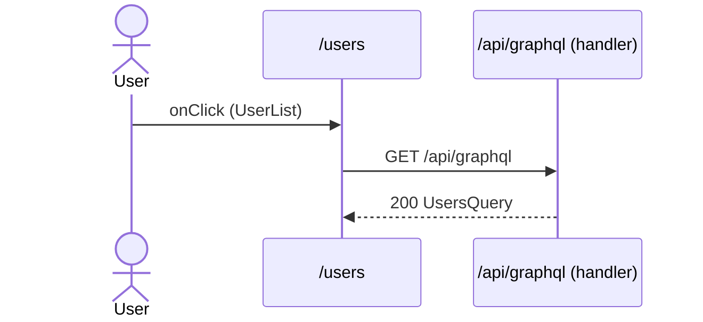

# Flow: UserList click

[← Overview](../README.md)

|  |  |
| --- | --- |
| Starts | [`UserList`](../components/UserList.md) on [`/users`](../pages/users.md) |
| Pages | [`/users`](../pages/users.md) |
| Status | not walked yet |

## Sequence



## Steps

| # | Step | Detail |
| ---: | --- | --- |
| 1 | User `onClick` in [`UserList`](../components/UserList.md) on [`/users`](../pages/users.md) | `src/components/UserList.tsx:27` |
| 2 | [`GET /api/graphql`](#req_0m0edcldv9l) | response `UsersQuery` · ✓ verified (1 capture) |

## Requests

### <a id="req_0m0edcldv9l"></a>`GET /api/graphql`

|  |  |
| --- | --- |
| Status | ✓ verified (1 capture) |
| From | [`UserList`](../components/UserList.md) · `src/components/UserList.tsx:21` |
| Trigger | event onClick |
| Transport | graphql · `client.query` |
| URL | `/api/graphql` |
| GraphQL | [`Users`](../graphql.md#operation-Users) (query) |
| Handled by | [`/api/graphql`](../pages/api.graphql.md) |

**Response** `UsersQuery`

```ts
{ users: { id: string; name: string; email: string }[] }
```

**Captured** `GET http://localhost:3077/api/graphql` → 200 OK · 25 ms · 2026-10-30 10:34 UTC · page `/users`

Request body:

```json
{
  "query": "query Users {\n  users {\n    id\n    name\n    email\n    __typename\n  }\n}",
  "operationName": "Users",
  "variables": {}
}
```

Response body:

```json
{
  "data": {
    "users": [
      {
        "id": "u1",
        "name": "Ada Lovelace",
        "email": "ada@example.com",
        "__typename": "User"
      },
      {
        "id": "u2",
        "name": "Grace Hopper",
        "email": "grace@example.com",
        "__typename": "User"
      },
      {
        "id": "u3",
        "name": "Alan Turing",
        "email": "alan@example.com",
        "__typename": "User"
      }
    ]
  }
}
```
