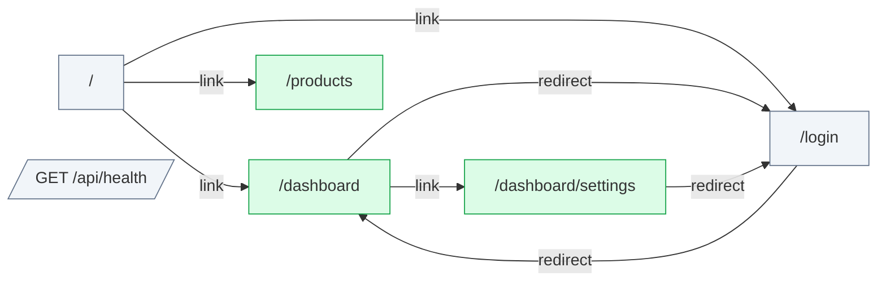

# middleware: flow map

Generated by flow-checker v0.0.0-test on 2026-10-29 12:00 UTC from a scan of `app` (Next.js 16.4.3).

> Captured requests in these docs are redacted: passwords, tokens and other sensitive values are masked.

## Summary

|  | Count |
| --- | ---: |
| Pages | 5 |
| Route handlers | 1 |
| Components | 6 |
| Requests | 4 |
| Endpoints | [5](endpoints.md) |
| Flows | 0 |
| Types | 3 |

## Verification

- **4 of 4 requests verified** by live capture (100%).
- 8 captures: 8 matched, 0 ambiguous, 0 unmatched.

No open issues. [All types](types.md).

## Route map

Green: every request verified. Red: a type mismatch. Amber: needs a re-check. Grey: not verified yet. Dotted: calls a route handler.

## Pages

| Page | File | Requests | Status |
| --- | --- | --- | --- |
| [`/`](pages/index.md) | `app/page.tsx` | 0 | — |
| [`/dashboard`](pages/dashboard.md) | `app/dashboard/page.tsx` | 1 | ✓ 1 verified |
| [`/dashboard/settings`](pages/dashboard.settings.md) | `app/dashboard/settings/page.tsx` | 1 | ✓ 1 verified |
| [`/login`](pages/login.md) | `app/login/page.tsx` | 0 | — |
| [`/products`](pages/products.md) | `app/products/page.tsx` | 1 | ✓ 1 verified |

## Route handlers

| Route | Methods | File | Requests it sends |
| --- | --- | --- | --- |
| [`/api/health`](pages/api.health.md) | GET | `app/api/health/route.ts` | 0 |

## Backends

| Host | Endpoints | Called from the browser |
| --- | ---: | ---: |
| [This app's API](endpoints.md#host-app) | 1 | 0 |
| [`{API_URL ?? http://localhost:4010}`](endpoints.md#host-env_API_URL) | 4 | 0 |

## Middleware

[`proxy.ts`](middleware.md): runs on 3 routes (1 only for some requests), 4 redirects, 1 rewrite, 1 request.

## Components

| Component | Kind | File | Requests |
| --- | --- | --- | --- |
| [`DashboardPage`](components/DashboardPage.md) | server | `app/dashboard/page.tsx:6` | 1 |
| [`SettingsPage`](components/SettingsPage.md) | server | `app/dashboard/settings/page.tsx:5` | 1 |
| [`RootLayout`](components/RootLayout.md) | server | `app/layout.tsx:6` | 0 |
| [`LoginPage`](components/LoginPage.md) | server | `app/login/page.tsx:1` | 0 |
| [`HomePage`](components/HomePage.md) | server | `app/page.tsx:3` | 0 |
| [`ProductsPage`](components/ProductsPage.md) | server | `app/products/page.tsx:5` | 1 |
