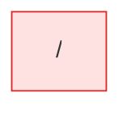

# mismatch: flow map

Generated by flow-checker v0.0.0-test on 2026-10-29 12:00 UTC from a scan of `app` (Next.js 16.4.3).

> Captured requests in these docs are redacted: passwords, tokens and other sensitive values are masked.

## Summary

|  | Count |
| --- | ---: |
| Pages | 1 |
| Route handlers | 0 |
| Components | 4 |
| Requests | 4 |
| Flows | 1 |
| Types | 4 |

## Verification

- **4 of 4 requests verified** by live capture (100%).
- 3 requests with a type mismatch, 0 requests to re-check after a code change.
- 7 captures: 7 matched, 0 ambiguous, 0 unmatched.
- Flows: 0 confirmed, 0 partly walked, 1 not walked yet.

[4 open issues](issues.md). [All types](types.md).

## Route map

Green: every request verified. Red: a type mismatch. Amber: needs a re-check. Grey: not verified yet. Dotted: calls a route handler.

## Pages

| Page | File | Requests | Status |
| --- | --- | --- | --- |
| [`/`](pages/index.md) | `app/page.tsx` | 4 | ✓ 1 verified, ✗ 3 mismatch |

## Flows

| Flow | Pages | Status |
| --- | --- | --- |
| [TodoPanel submit](flows/todopanel-submit.md) | `/` | not walked yet |

## Components

| Component | Kind | File | Requests |
| --- | --- | --- | --- |
| [`RootLayout`](components/RootLayout.md) | server | `app/layout.tsx:5` | 0 |
| [`HomePage`](components/HomePage.md) | server | `app/page.tsx:8` | 1 |
| [`SettingsPanel`](components/SettingsPanel.md) | client | `components/SettingsPanel.tsx:8` | 1 |
| [`TodoPanel`](components/TodoPanel.md) | client | `components/TodoPanel.tsx:9` | 2 |
