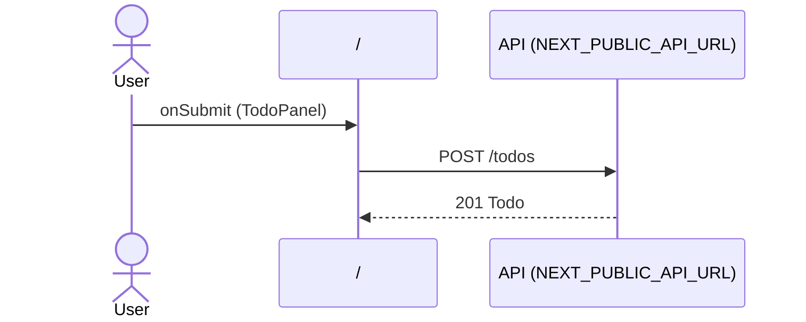

# Flow: TodoPanel submit

[← Overview](../README.md)

|  |  |
| --- | --- |
| Starts | [`TodoPanel`](../components/TodoPanel.md) on [`/`](../pages/index.md) |
| Pages | [`/`](../pages/index.md) |
| Status | not walked yet |

## Sequence



## Steps

| # | Step | Detail |
| ---: | --- | --- |
| 1 | User `onSubmit` in [`TodoPanel`](../components/TodoPanel.md) on [`/`](../pages/index.md) | `components/TodoPanel.tsx:34` |
| 2 | [`POST {NEXT_PUBLIC_API_URL ?? http://localhost:4010}/todos`](#req_1m9d40sdmxx) | body `NewTodo` · response `Todo` · ✗ type mismatch (1 capture) |

## Requests

### <a id="req_1m9d40sdmxx"></a>`POST {NEXT_PUBLIC_API_URL ?? http://localhost:4010}/todos`

|  |  |
| --- | --- |
| Status | ✗ type mismatch (1 capture) |
| From | [`TodoPanel`](../components/TodoPanel.md) · `components/TodoPanel.tsx:19` |
| Trigger | event onSubmit |
| Transport | fetch |
| URL | `{NEXT_PUBLIC_API_URL ?? http://localhost:4010}/todos` |
| Call path | `createTodo` → `fetch` |

> ⚠ **[type-mismatch](../GLOSSARY.md#flag-type-mismatch)**: Response doesn't match Todo: userId is string "1" (expected number). Request body doesn't match NewTodo: userId is string "1" (expected number) (1 of 1 capture).

**Request body** [`NewTodo`](../types.md#typ_1hvhy5iwv7p)

```ts
{ title: string; userId: number }
```

**Response** [`Todo`](../types.md#typ_29n1iw0u1hd)

```ts
{ id: number; userId: number; title: string; done: boolean }
```

**Type check**: 1 of 1 checked capture didn't match.

| Part | Field | Problem | Expected | Captured | Captures |
| --- | --- | --- | --- | --- | ---: |
| request body | `userId` | wrong-type | `number` | `string "1"` | 1 |
| response | `userId` | wrong-type | `number` | `string "1"` | 1 |

**Captured** `POST http://localhost:4010/todos` → 201 Created · 10 ms · 2026-10-29 12:38 UTC · page `/`

Request body:

```json
{
  "title": "Check types",
  "userId": "1"
}
```

Response body:

```json
{
  "id": 3,
  "userId": "1",
  "done": false,
  "title": "Check types"
}
```
