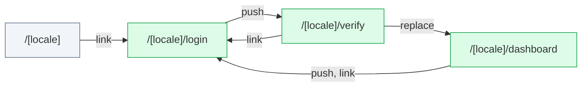

# next-intl: flow map

Generated by flow-checker v0.0.0-test on 2026-10-29 12:00 UTC from a scan of `src/app` (Next.js 16.4.3).

> Captured requests in these docs are redacted: passwords, tokens and other sensitive values are masked.

## Summary

|  | Count |
| --- | ---: |
| Pages | 4 |
| Route handlers | 0 |
| Components | 8 |
| Requests | 3 |
| Flows | 1 |
| Types | 6 |

## Verification

- **3 of 3 requests verified** by live capture (100%).
- 4 captures: 4 matched, 0 ambiguous, 0 unmatched.
- Flows: 0 confirmed, 0 partly walked, 1 not walked yet.

[1 open issue](issues.md). [All types](types.md).

## Route map

Green: every request verified. Red: a type mismatch. Amber: needs a re-check. Grey: not verified yet. Dotted: calls a route handler.

## Pages

| Page | File | Requests | Status |
| --- | --- | --- | --- |
| [`/[locale]`](pages/%5Blocale%5D.md) | `src/app/[locale]/page.tsx` | 0 | — |
| [`/[locale]/dashboard`](pages/%5Blocale%5D.dashboard.md) | `src/app/[locale]/dashboard/page.tsx` | 1 | ✓ 1 verified |
| [`/[locale]/login`](pages/%5Blocale%5D.login.md) | `src/app/[locale]/login/page.tsx` | 1 | ✓ 1 verified |
| [`/[locale]/verify`](pages/%5Blocale%5D.verify.md) | `src/app/[locale]/verify/page.tsx` | 1 | ✓ 1 verified |

## Middleware

[`src/proxy.ts`](middleware.md): runs on 4 routes, 0 redirects, 0 rewrites, 0 requests.

## Flows

| Flow | Pages | Status |
| --- | --- | --- |
| [LoginForm submit](flows/loginform-submit.md) | `/[locale]/login` → `/[locale]/verify` → `/[locale]/dashboard` | not walked yet |

## Components

| Component | Kind | File | Requests |
| --- | --- | --- | --- |
| [`DashboardPage`](components/DashboardPage.md) | server | `src/app/[locale]/dashboard/page.tsx:3` | 0 |
| [`LocaleLayout`](components/LocaleLayout.md) | server | `src/app/[locale]/layout.tsx:11` | 0 |
| [`LoginPage`](components/LoginPage.md) | server | `src/app/[locale]/login/page.tsx:3` | 0 |
| [`HomePage`](components/HomePage.md) | server | `src/app/[locale]/page.tsx:4` | 0 |
| [`VerifyPage`](components/VerifyPage.md) | server | `src/app/[locale]/verify/page.tsx:3` | 0 |
| [`DashboardProfile`](components/DashboardProfile.md) | client | `src/components/DashboardProfile.tsx:10` | 1 |
| [`LoginForm`](components/LoginForm.md) | client | `src/components/LoginForm.tsx:9` | 1 |
| [`VerifyOtpForm`](components/VerifyOtpForm.md) | client | `src/components/VerifyOtpForm.tsx:13` | 1 |
