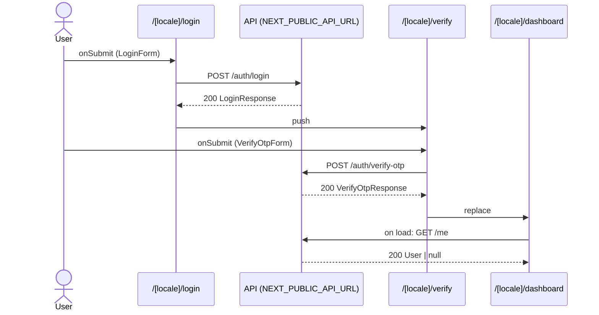

# Flow: LoginForm submit

[← Overview](../README.md)

|  |  |
| --- | --- |
| Starts | [`LoginForm`](../components/LoginForm.md) on [`/[locale]/login`](../pages/%5Blocale%5D.login.md) |
| Pages | [`/[locale]/login`](../pages/%5Blocale%5D.login.md) → [`/[locale]/verify`](../pages/%5Blocale%5D.verify.md) → [`/[locale]/dashboard`](../pages/%5Blocale%5D.dashboard.md) |
| Status | not walked yet |

## Sequence



## Steps

| # | Step | Detail |
| ---: | --- | --- |
| 1 | User `onSubmit` in [`LoginForm`](../components/LoginForm.md) on [`/[locale]/login`](../pages/%5Blocale%5D.login.md) | `src/components/LoginForm.tsx:29` |
| 2 | [`POST {NEXT_PUBLIC_API_URL ?? http://localhost:4010}/auth/login`](#req_0ldgejuv5rs) | body `LoginRequest` · response `LoginResponse` · ✓ verified (1 capture) |
| 3 | push → [`/[locale]/verify`](../pages/%5Blocale%5D.verify.md) | on success · `src/components/LoginForm.tsx:22` |
| 4 | User `onSubmit` in [`VerifyOtpForm`](../components/VerifyOtpForm.md) on [`/[locale]/verify`](../pages/%5Blocale%5D.verify.md) | `src/components/VerifyOtpForm.tsx:36` |
| 5 | [`POST {NEXT_PUBLIC_API_URL ?? http://localhost:4010}/auth/verify-otp`](#req_0ivpze9dolu) | body `VerifyOtpRequest` · response `VerifyOtpResponse` · ✓ verified (1 capture) |
| 6 | replace → [`/[locale]/dashboard`](../pages/%5Blocale%5D.dashboard.md) | on success · `src/components/VerifyOtpForm.tsx:29` |
| 7 | Page loads: [`GET {NEXT_PUBLIC_API_URL ?? http://localhost:4010}/me`](#req_1ostg0bhzmk) | response `User \| null` · ✓ verified (2 captures) |

## Requests

### <a id="req_0ldgejuv5rs"></a>`POST {NEXT_PUBLIC_API_URL ?? http://localhost:4010}/auth/login`

|  |  |
| --- | --- |
| Status | ✓ verified (1 capture) |
| From | [`LoginForm`](../components/LoginForm.md) · `src/components/LoginForm.tsx:18` |
| Trigger | event onSubmit |
| Transport | fetch |
| URL | `{NEXT_PUBLIC_API_URL ?? http://localhost:4010}/auth/login` |
| Call path | `login` → `post` → `fetch` |

**Request body** [`LoginRequest`](../types.md#typ_0soatqi8re7)

```ts
{ email: string; password: string }
```

**Response** [`LoginResponse`](../types.md#typ_1ywasj4ylf5)

```ts
{ otpRequired: true; challengeId: string }
```

**Captured** `POST http://localhost:4010/auth/login` → 200 OK · 12 ms · 2026-10-28 10:58 UTC · page `/en/login`

Request body:

```json
{
  "email": "ada@example.com",
  "password": "[REDACTED:string]"
}
```

Response body:

```json
{
  "otpRequired": true,
  "challengeId": "515708eb-7e2d-462b-b51a-de5c05e6f6f7"
}
```

Masked: `request.body.password`

### <a id="req_0ivpze9dolu"></a>`POST {NEXT_PUBLIC_API_URL ?? http://localhost:4010}/auth/verify-otp`

|  |  |
| --- | --- |
| Status | ✓ verified (1 capture) |
| From | [`VerifyOtpForm`](../components/VerifyOtpForm.md) · `src/components/VerifyOtpForm.tsx:27` |
| Trigger | event onSubmit |
| Transport | fetch |
| URL | `{NEXT_PUBLIC_API_URL ?? http://localhost:4010}/auth/verify-otp` |
| Call path | `verifyOtp` → `post` → `fetch` |

**Request body** [`VerifyOtpRequest`](../types.md#typ_0picqcg78cw)

```ts
{ challengeId: string; code: string }
```

**Response** [`VerifyOtpResponse`](../types.md#typ_1pi4a892sek)

```ts
{ token: string; user: User }
```

**Captured** `POST http://localhost:4010/auth/verify-otp` → 200 OK · 7 ms · 2026-10-28 10:58 UTC · page `/en/verify`

Request body:

```json
{
  "challengeId": "515708eb-7e2d-462b-b51a-de5c05e6f6f7",
  "code": "[REDACTED:string]"
}
```

Response body:

```json
{
  "token": "[REDACTED:string]",
  "user": {
    "id": 1,
    "name": "Ada Lovelace",
    "email": "ada@example.com",
    "role": "admin"
  }
}
```

Masked: `request.body.code`, `response.body.token`

### <a id="req_1ostg0bhzmk"></a>`GET {NEXT_PUBLIC_API_URL ?? http://localhost:4010}/me`

|  |  |
| --- | --- |
| Status | ✓ verified (2 captures) |
| From | [`DashboardProfile`](../components/DashboardProfile.md) · `src/components/DashboardProfile.tsx:16` |
| Trigger | effect |
| Transport | fetch |
| URL | `{NEXT_PUBLIC_API_URL ?? http://localhost:4010}/me` |
| Call path | `getMe` → `fetch` |

**Response** `User | null` (see [`User`](../types.md#typ_1tpxqokvkch))

**Captured** `GET http://localhost:4010/me` → 200 OK · 55 ms · 2026-10-28 10:58 UTC · page `/en/dashboard` (newest of 2)

Response body:

```json
{
  "id": 1,
  "name": "Ada Lovelace",
  "email": "ada@example.com",
  "role": "admin"
}
```

Masked: `request.headers.authorization`
