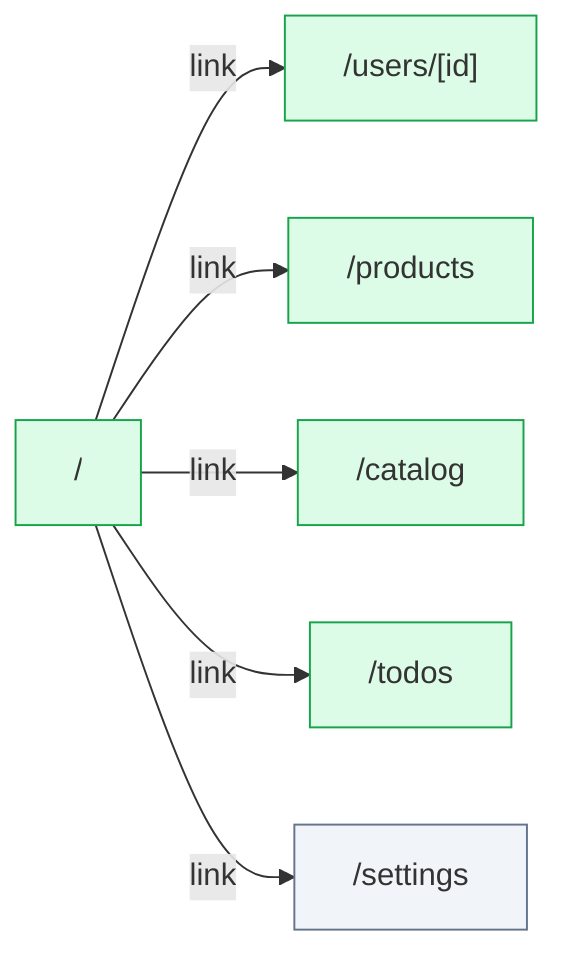

# perf: flow map

New to this app? [Start here](ONBOARDING.md) for a short tour; the [glossary](GLOSSARY.md) says what each status and note means.

Generated by flow-checker v0.0.0-test on 2026-10-29 12:00 UTC from a scan of `src/app` (Next.js 16.4.3).

> Captured requests in these docs are redacted: passwords, tokens and other sensitive values are masked.

## Summary

|  | Count |
| --- | ---: |
| Pages | 6 |
| Areas | [6](areas.md) |
| Route handlers | 0 |
| Components | 9 |
| Requests | 18 |
| Endpoints | [8](endpoints.md) |
| Flows | 0 |
| Types | 4 |

## Verification

- **13 of 18 requests verified** by live capture (72%).
- 44 captures: 38 matched, 6 ambiguous, 0 unmatched.

[14 open issues](issues.md). [All types](types.md).

## Route map

Green: every request verified. Red: a type mismatch. Amber: needs a re-check. Grey: not verified yet. Dotted: calls a route handler.

## Pages

| Page | File | Access | Rendering | Requests | Status |
| --- | --- | --- | --- | --- | --- |
| [`/`](pages/index.md) | `src/app/page.tsx` | open | dynamic | 2 | ✓ 2 verified |
| [`/catalog`](pages/catalog.md) | `src/app/catalog/page.tsx` | open | dynamic | 2 | ✓ 2 verified |
| [`/products`](pages/products.md) | `src/app/products/page.tsx` | open | dynamic | 2 | ✓ 2 verified |
| [`/settings`](pages/settings.md) | `src/app/settings/page.tsx` | open | dynamic | 6 | ✓ 1 verified, 5 inferred |
| [`/todos`](pages/todos.md) | `src/app/todos/page.tsx` | open | dynamic | 2 | ✓ 2 verified |
| [`/users/[id]`](pages/users.%5Bid%5D.md) | `src/app/users/[id]/page.tsx` | guarded | dynamic | 4 | ✓ 4 verified |

## Areas

| Area | Pages | Flows | Endpoints |
| --- | ---: | ---: | ---: |
| [home](areas.md#ar_1vn39fso9m3) | 1 | 0 | 2 |
| [catalog](areas.md#ar_2buzu539ylk) | 1 | 0 | 2 |
| [products](areas.md#ar_2erkuzrjb5u) | 1 | 0 | 2 |
| [settings](areas.md#ar_1jfq6xl49zk) | 1 | 0 | 3 |
| [todos](areas.md#ar_1zap1ick15k) | 1 | 0 | 2 |
| [users](areas.md#ar_0tirr3qjab5) | 1 | 0 | 3 |

## Environment variables

[4 names read, 0 `.env` files](env.md).

## Request performance

[5 request performance notes, 8 endpoints timed](perf.md).

## Backends

| Host | Endpoints | Called from the browser |
| --- | ---: | ---: |
| [`http://localhost:4010`](endpoints.md#host-base_http___localhost_4010) | 8 | 1 |

## Components

| Component | Kind | File | Requests |
| --- | --- | --- | --- |
| [`CatalogPage`](components/CatalogPage.md) | server | `src/app/catalog/page.tsx:4` | 2 |
| [`RootLayout`](components/RootLayout.md) | server | `src/app/layout.tsx:9` | 0 |
| [`Home`](components/Home.md) | server | `src/app/page.tsx:4` | 2 |
| [`ProductsPage`](components/ProductsPage.md) | server | `src/app/products/page.tsx:5` | 2 |
| [`SettingsLayout`](components/SettingsLayout.md) | server | `src/app/settings/layout.tsx:7` | 3 |
| [`SettingsPage`](components/SettingsPage.md) | server | `src/app/settings/page.tsx:4` | 3 |
| [`TodosPage`](components/TodosPage.md) | server | `src/app/todos/page.tsx:5` | 1 |
| [`UserPage`](components/UserPage.md) | server | `src/app/users/[id]/page.tsx:5` | 4 |
| [`TodoRow`](components/TodoRow.md) | client | `src/components/todo-row.tsx:5` | 1 |
