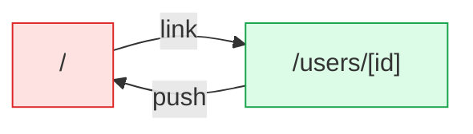

# postman: flow map

Generated by flow-checker v0.0.0-test on 2026-10-29 12:00 UTC from a scan of `app` (Next.js 16.4.3).

> Captured requests in these docs are redacted: passwords, tokens and other sensitive values are masked.

## Summary

|  | Count |
| --- | ---: |
| Pages | 2 |
| Areas | [2](areas.md) |
| Route handlers | 0 |
| Components | 6 |
| Requests | 6 |
| Endpoints | [6](endpoints.md) |
| Flows | 2 |
| Types | 4 |

## Verification

- **6 of 6 requests verified** by live capture (100%).
- 1 request with a type mismatch, 0 requests to re-check after a code change.
- 14 captures: 14 matched, 0 ambiguous, 0 unmatched.
- Flows: 0 confirmed, 0 partly walked, 2 not walked yet.

[5 open issues](issues.md). [All types](types.md).

## Route map

Green: every request verified. Red: a type mismatch. Amber: needs a re-check. Grey: not verified yet. Dotted: calls a route handler.

## Pages

| Page | File | Access | Requests | Status |
| --- | --- | --- | --- | --- |
| [`/`](pages/index.md) | `app/page.tsx` | open | 4 | ✓ 3 verified, ✗ 1 mismatch |
| [`/users/[id]`](pages/users.%5Bid%5D.md) | `app/users/[id]/page.tsx` | open | 2 | ✓ 2 verified |

## Areas

| Area | Pages | Flows | Endpoints |
| --- | ---: | ---: | ---: |
| [home](areas.md#ar_1vn39fso9m3) | 1 | 1 | 4 |
| [users](areas.md#ar_0tirr3qjab5) | 1 | 1 | 2 |

## Backends

| Host | Endpoints | Called from the browser |
| --- | ---: | ---: |
| [`http://localhost:4010`](endpoints.md#host-base_http___localhost_4010) | 1 | 1 |
| [`{NEXT_PUBLIC_API_URL ?? http://localhost:4010}`](endpoints.md#host-env_NEXT_PUBLIC_API_URL) | 5 | 3 |

## Postman collection

[Fixture API](postman.md): 5 of 7 requests called by the app, 2 unused endpoints, 1 request in the code not in the collection, 1 contract mismatch.

## Flows

| Flow | Pages | Status |
| --- | --- | --- |
| [DeleteUserButton click](flows/deleteuserbutton-click.md) | `/users/[id]` → `/` | not walked yet |
| [TodoPanel submit](flows/todopanel-submit.md) | `/` | not walked yet |

## Components

| Component | Kind | File | Requests |
| --- | --- | --- | --- |
| [`RootLayout`](components/RootLayout.md) | server | `app/layout.tsx:5` | 0 |
| [`HomePage`](components/HomePage.md) | server | `app/page.tsx:9` | 1 |
| [`UserPage`](components/UserPage.md) | server | `app/users/[id]/page.tsx:7` | 1 |
| [`DeleteUserButton`](components/DeleteUserButton.md) | client | `components/DeleteUserButton.tsx:7` | 1 |
| [`ProductPanel`](components/ProductPanel.md) | client | `components/ProductPanel.tsx:7` | 1 |
| [`TodoPanel`](components/TodoPanel.md) | client | `components/TodoPanel.tsx:8` | 2 |
