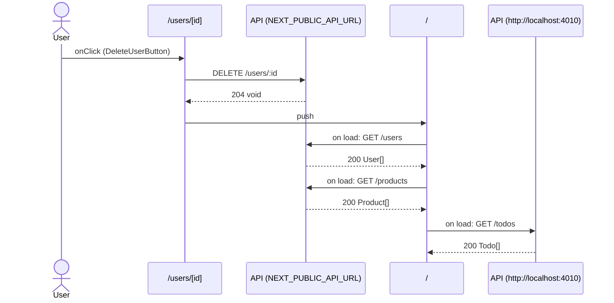

# Flow: DeleteUserButton click

[← Overview](../README.md)

|  |  |
| --- | --- |
| Starts | [`DeleteUserButton`](../components/DeleteUserButton.md) on [`/users/[id]`](../pages/users.%5Bid%5D.md) |
| Pages | [`/users/[id]`](../pages/users.%5Bid%5D.md) → [`/`](../pages/index.md) |
| Status | not walked yet |

## Sequence



## Steps

| # | Step | Detail |
| ---: | --- | --- |
| 1 | User `onClick` in [`DeleteUserButton`](../components/DeleteUserButton.md) on [`/users/[id]`](../pages/users.%5Bid%5D.md) | `components/DeleteUserButton.tsx:12` |
| 2 | [`DELETE {NEXT_PUBLIC_API_URL ?? http://localhost:4010}/users/:id`](#req_1nhvqmicx4q) | response `void` · ✓ verified (1 capture) |
| 3 | push → [`/`](../pages/index.md) | `components/DeleteUserButton.tsx:14` |
| 4 | Page loads: [`GET {NEXT_PUBLIC_API_URL ?? http://localhost:4010}/users`](#req_0iv5kcsl9up) | response `User[]` · ✓ verified (3 captures) |
| 5 | Page loads: [`GET {NEXT_PUBLIC_API_URL ?? http://localhost:4010}/products`](#req_08kv7zxxjyg) | response `Product[]` · ✗ type mismatch (4 captures) |
| 6 | Page loads: [`GET http://localhost:4010/todos`](#req_1e93pbv41le) | response `Todo[]` · ✓ verified (4 captures) |

## Requests

### <a id="req_1nhvqmicx4q"></a>`DELETE {NEXT_PUBLIC_API_URL ?? http://localhost:4010}/users/:id`

|  |  |
| --- | --- |
| Status | ✓ verified (1 capture) |
| From | [`DeleteUserButton`](../components/DeleteUserButton.md) · `components/DeleteUserButton.tsx:13` |
| Trigger | event onClick |
| Transport | fetch |
| URL | `{NEXT_PUBLIC_API_URL ?? http://localhost:4010}/users/:id` (pattern) |
| Call path | `deleteUser` → `fetch` |

> ⚠ **[not-in-collection](../GLOSSARY.md#flag-not-in-collection)**: The Postman collection "Fixture API" has no DELETE /users/:id request.

**Response** `void`

**Captured** `DELETE http://localhost:4010/users/2` → 204 No Content · 7 ms · 2026-10-30 04:06 UTC · page `/users/2`

### <a id="req_0iv5kcsl9up"></a>`GET {NEXT_PUBLIC_API_URL ?? http://localhost:4010}/users`

|  |  |
| --- | --- |
| Status | ✓ verified (3 captures) |
| From | [`HomePage`](../components/HomePage.md) · `app/page.tsx:10` |
| Trigger | server-render |
| Transport | fetch |
| URL | `{NEXT_PUBLIC_API_URL ?? http://localhost:4010}/users` |
| Postman | [List users](../postman.md#pmr_0juh4djhx8l) |
| Call path | `getUsers` → `fetch` |

**Response** `User[]` (see [`User`](../types.md#typ_2ao02lpx6nv))

**Captured** `GET http://localhost:4010/users` → 200 OK · 8 ms · 2026-10-30 04:06 UTC (newest of 3)

Response body:

```json
[
  {
    "id": 1,
    "name": "Ada Lovelace",
    "email": "ada@example.com",
    "role": "admin"
  }
]
```

### <a id="req_08kv7zxxjyg"></a>`GET {NEXT_PUBLIC_API_URL ?? http://localhost:4010}/products`

|  |  |
| --- | --- |
| Status | ✗ type mismatch (4 captures) |
| From | [`ProductPanel`](../components/ProductPanel.md) · `components/ProductPanel.tsx:11` |
| Trigger | effect |
| Transport | fetch |
| URL | `{NEXT_PUBLIC_API_URL ?? http://localhost:4010}/products` |
| Postman | [List products](../postman.md#pmr_266pqs2sv5q) |
| Call path | `getProducts` → `fetch` |

> ⚠ **[contract-mismatch](../GLOSSARY.md#flag-contract-mismatch)**: The response type Product\[\] doesn't match the Postman example "200 OK": \[\].price is number 49.9 (expected string).
>
> ⚠ **[type-mismatch](../GLOSSARY.md#flag-type-mismatch)**: Response doesn't match Product\[\]: \[\].price is number 49.9 (expected string) (4 of 4 captures).

**Response** `Product[]` (see [`Product`](../types.md#typ_1f1vojxmn7g))

**Type check**: 4 of 4 checked captures didn't match.

| Part | Field | Problem | Expected | Captured | Captures |
| --- | --- | --- | --- | --- | ---: |
| response | `[].price` | wrong-type | `string` | `number 49.9` | 4 |

**Captured** `GET http://localhost:4010/products` → 200 OK · 5 ms · 2026-10-30 04:06 UTC · page `/` (newest of 4)

Response body:

```json
[
  {
    "id": 1,
    "name": "Keyboard",
    "price": 49.9,
    "stock": 12
  },
  {
    "id": 2,
    "name": "Mouse",
    "price": 19.5,
    "stock": 0
  }
]
```

### <a id="req_1e93pbv41le"></a>`GET http://localhost:4010/todos`

|  |  |
| --- | --- |
| Status | ✓ verified (4 captures) |
| From | [`TodoPanel`](../components/TodoPanel.md) · `components/TodoPanel.tsx:12` |
| Trigger | effect |
| Transport | fetch |
| URL | `http://localhost:4010/todos` (from Postman) |
| Postman | [List todos](../postman.md#pmr_1786nvyhcbb) · matched by name and method, URL from the collection |
| Call path | `listTodos` → `fetch` |

**Response** `Todo[]` (see [`Todo`](../types.md#typ_29n1iw0u1hd))

**Captured** `GET http://localhost:4010/todos` → 200 OK · 6 ms · 2026-10-30 04:06 UTC · page `/` (newest of 4)

Response body:

```json
[
  {
    "id": 1,
    "userId": 1,
    "title": "Write the first program",
    "done": true
  },
  {
    "id": 2,
    "userId": 2,
    "title": "Break Enigma",
    "done": false
  },
  {
    "id": 3,
    "userId": 1,
    "done": false,
    "title": "Check the contract"
  }
]
```
