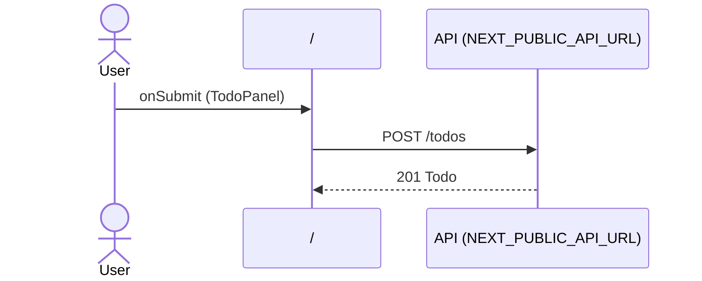

# Flow: TodoPanel submit

[← Overview](../README.md)

|  |  |
| --- | --- |
| Starts | [`TodoPanel`](../components/TodoPanel.md) on [`/`](../pages/index.md) |
| Pages | [`/`](../pages/index.md) |
| Status | not walked yet |

## Sequence



## Steps

| # | Step | Detail |
| ---: | --- | --- |
| 1 | User `onSubmit` in [`TodoPanel`](../components/TodoPanel.md) on [`/`](../pages/index.md) | `components/TodoPanel.tsx:30` |
| 2 | [`POST {NEXT_PUBLIC_API_URL ?? http://localhost:4010}/todos`](#req_07zzxwzir2w) | body `NewTodo` · response `Todo` · ✓ verified (1 capture) |

## Requests

### <a id="req_07zzxwzir2w"></a>`POST {NEXT_PUBLIC_API_URL ?? http://localhost:4010}/todos`

|  |  |
| --- | --- |
| Status | ✓ verified (1 capture) |
| From | [`TodoPanel`](../components/TodoPanel.md) · `components/TodoPanel.tsx:18` |
| Trigger | event onSubmit |
| Transport | fetch |
| URL | `{NEXT_PUBLIC_API_URL ?? http://localhost:4010}/todos` |
| Postman | [Create todo](../postman.md#pmr_1jsi4tlr1i9) |
| Call path | `createTodo` → `fetch` |

**Request body** [`NewTodo`](../types.md#typ_1hvhy5iwv7p)

```ts
{ title: string; userId: number }
```

**Response** [`Todo`](../types.md#typ_29n1iw0u1hd)

```ts
{ id: number; userId: number; title: string; done: boolean }
```

**Captured** `POST http://localhost:4010/todos` → 201 Created · 6 ms · 2026-10-30 04:06 UTC · page `/`

Request body:

```json
{
  "title": "Check the contract",
  "userId": 1
}
```

Response body:

```json
{
  "id": 3,
  "userId": 1,
  "done": false,
  "title": "Check the contract"
}
```
