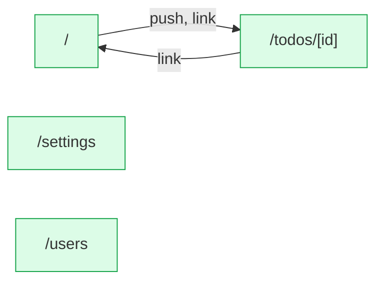

# react-query: flow map

Generated by flow-checker v0.0.0-test on 2026-10-29 12:00 UTC from a scan of `src/app` (Next.js 16.4.3).

> Captured requests in these docs are redacted: passwords, tokens and other sensitive values are masked.

## Summary

|  | Count |
| --- | ---: |
| Pages | 4 |
| Route handlers | 0 |
| Components | 12 |
| Requests | 13 |
| Endpoints | [7](endpoints.md) |
| Flows | 4 |
| Types | 6 |

## Verification

- **13 of 13 requests verified** by live capture (100%).
- 19 captures: 17 matched, 2 ambiguous, 0 unmatched.
- Flows: 0 confirmed, 0 partly walked, 4 not walked yet.

[6 open issues](issues.md). [All types](types.md).

## Route map

Green: every request verified. Red: a type mismatch. Amber: needs a re-check. Grey: not verified yet. Dotted: calls a route handler.

## Pages

| Page | File | Requests | Status |
| --- | --- | --- | --- |
| [`/`](pages/index.md) | `src/app/page.tsx` | 3 | ✓ 3 verified |
| [`/settings`](pages/settings.md) | `src/app/settings/page.tsx` | 4 | ✓ 4 verified |
| [`/todos/[id]`](pages/todos.%5Bid%5D.md) | `src/app/todos/[id]/page.tsx` | 1 | ✓ 1 verified |
| [`/users`](pages/users.md) | `src/app/users/page.tsx` | 5 | ✓ 5 verified |

## Backends

| Host | Endpoints | Called from the browser |
| --- | ---: | ---: |
| [`{NEXT_PUBLIC_API_URL ?? http://localhost:4010}`](endpoints.md#host-env_NEXT_PUBLIC_API_URL) | 7 | 7 |

## Flows

| Flow | Pages | Status |
| --- | --- | --- |
| [AddTodoForm submit](flows/addtodoform-submit.md) | `/` → `/todos/[id]` | not walked yet |
| [TodoList change](flows/todolist-change.md) | `/` | not walked yet |
| [UserList mouseenter](flows/userlist-mouseenter.md) | `/users` | not walked yet |
| [UserList click](flows/userlist-click.md) | `/users` | not walked yet |

## Components

| Component | Kind | File | Requests |
| --- | --- | --- | --- |
| [`RootLayout`](components/RootLayout.md) | server | `src/app/layout.tsx:6` | 0 |
| [`TodosPage`](components/TodosPage.md) | server | `src/app/page.tsx:4` | 0 |
| [`Providers`](components/Providers.md) | client | `src/app/providers.tsx:6` | 0 |
| [`SettingsPage`](components/SettingsPage.md) | server | `src/app/settings/page.tsx:4` | 0 |
| [`TodoPage`](components/TodoPage.md) | server | `src/app/todos/[id]/page.tsx:3` | 0 |
| [`UsersPage`](components/UsersPage.md) | server | `src/app/users/page.tsx:6` | 1 |
| [`AddTodoForm`](components/AddTodoForm.md) | client | `src/components/AddTodoForm.tsx:9` | 1 |
| [`SettingsBadge`](components/SettingsBadge.md) | client | `src/components/SettingsBadge.tsx:8` | 1 |
| [`SettingsPanel`](components/SettingsPanel.md) | client | `src/components/SettingsPanel.tsx:13` | 3 |
| [`TodoDetail`](components/TodoDetail.md) | client | `src/components/TodoDetail.tsx:13` | 1 |
| [`TodoList`](components/TodoList.md) | client | `src/components/TodoList.tsx:9` | 2 |
| [`UserList`](components/UserList.md) | client | `src/components/UserList.tsx:7` | 4 |
