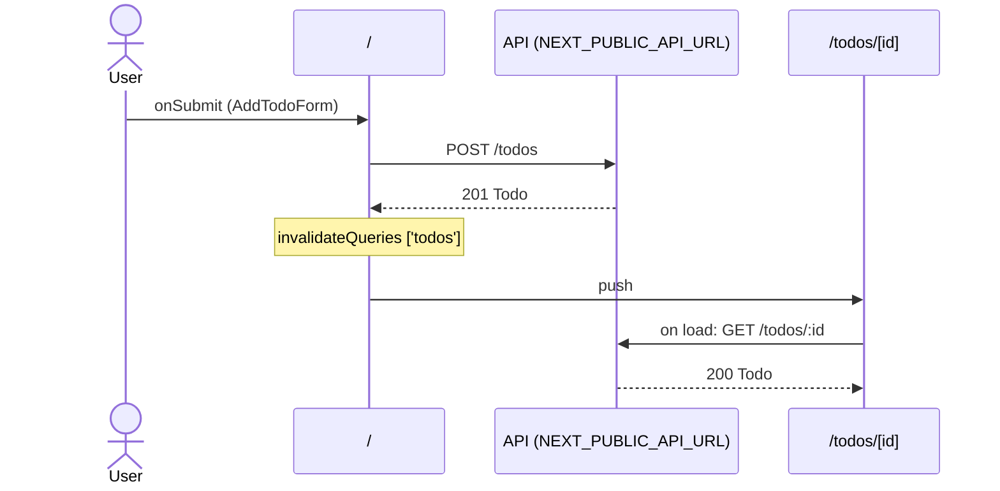

# Flow: AddTodoForm submit

[← Overview](../README.md)

|  |  |
| --- | --- |
| Starts | [`AddTodoForm`](../components/AddTodoForm.md) on [`/`](../pages/index.md) |
| Pages | [`/`](../pages/index.md) → [`/todos/[id]`](../pages/todos.%5Bid%5D.md) |
| Status | not walked yet |

## Sequence



## Steps

| # | Step | Detail |
| ---: | --- | --- |
| 1 | User `onSubmit` in [`AddTodoForm`](../components/AddTodoForm.md) on [`/`](../pages/index.md) | `src/components/AddTodoForm.tsx:28` |
| 2 | [`POST {NEXT_PUBLIC_API_URL ?? http://localhost:4010}/todos`](#req_1ybk9xw63lt) | body `NewTodo` · response `Todo` · ✓ verified (1 capture) |
| 3 | `invalidateQueries` `['todos']` | refetches `GET {NEXT_PUBLIC_API_URL ?? http://localhost:4010}/todos`, `GET {NEXT_PUBLIC_API_URL ?? http://localhost:4010}/todos?userId=:userId` · `src/components/AddTodoForm.tsx:17` |
| 4 | push → [`/todos/[id]`](../pages/todos.%5Bid%5D.md) | on success · `src/components/AddTodoForm.tsx:18` |
| 5 | Page loads: [`GET {NEXT_PUBLIC_API_URL ?? http://localhost:4010}/todos/:id`](#req_27sy7hb0xsq) | response `Todo` · ✓ verified (1 capture) |

## Requests

### <a id="req_1ybk9xw63lt"></a>`POST {NEXT_PUBLIC_API_URL ?? http://localhost:4010}/todos`

|  |  |
| --- | --- |
| Status | ✓ verified (1 capture) |
| From | [`AddTodoForm`](../components/AddTodoForm.md) · `src/components/AddTodoForm.tsx:14` |
| Trigger | event onSubmit |
| Transport | fetch · `useMutation` |
| URL | `{NEXT_PUBLIC_API_URL ?? http://localhost:4010}/todos` |
| Call path | `useMutation` → `http` → `fetch` |

**Request body** [`NewTodo`](../types.md#typ_1llbjxbqwwk)

```ts
{ title: string }
```

**Response** [`Todo`](../types.md#typ_0fc96ucq8sd)

```ts
{ id: number; userId: number; title: string; done: boolean }
```

**Captured** `POST http://localhost:4010/todos` → 201 Created · 8 ms · 2026-10-31 22:51 UTC · page `/`

Request body:

```json
{
  "title": "Record captures"
}
```

Response body:

```json
{
  "id": 3,
  "userId": 1,
  "done": false,
  "title": "Record captures"
}
```

### <a id="req_27sy7hb0xsq"></a>`GET {NEXT_PUBLIC_API_URL ?? http://localhost:4010}/todos/:id`

|  |  |
| --- | --- |
| Status | ✓ verified (1 capture) |
| From | [`TodoDetail`](../components/TodoDetail.md) · `src/components/TodoDetail.tsx:14` |
| Trigger | page-load |
| Transport | fetch · `useSWR(['todo', id])` |
| URL | `{NEXT_PUBLIC_API_URL ?? http://localhost:4010}/todos/:id` (pattern) |
| Call path | `useSWR` → `fetchTodo` → `http` → `fetch` |

**Response** [`Todo`](../types.md#typ_0fc96ucq8sd)

```ts
{ id: number; userId: number; title: string; done: boolean }
```

**Captured** `GET http://localhost:4010/todos/3` → 200 OK · 11 ms · 2026-10-31 22:51 UTC · page `/todos/3`

Response body:

```json
{
  "id": 3,
  "userId": 1,
  "done": false,
  "title": "Record captures"
}
```
