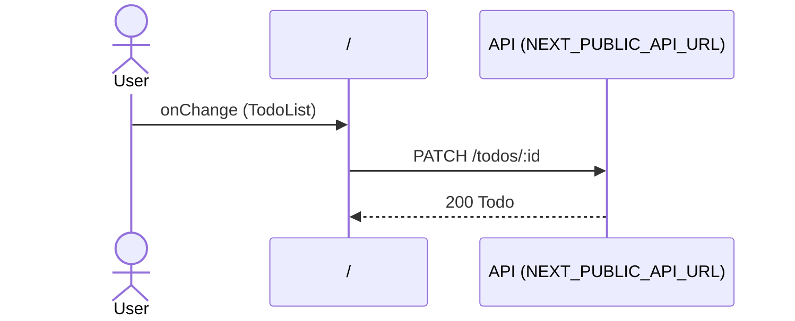

# Flow: TodoList change

[← Overview](../README.md)

|  |  |
| --- | --- |
| Starts | [`TodoList`](../components/TodoList.md) on [`/`](../pages/index.md) |
| Pages | [`/`](../pages/index.md) |
| Status | not walked yet |

## Sequence



## Steps

| # | Step | Detail |
| ---: | --- | --- |
| 1 | User `onChange` in [`TodoList`](../components/TodoList.md) on [`/`](../pages/index.md) | `src/components/TodoList.tsx:25` |
| 2 | [`PATCH {NEXT_PUBLIC_API_URL ?? http://localhost:4010}/todos/:id`](#req_0edpknxxbhl) | body `TodoPatch` · response `Todo` · ✓ verified (1 capture) |

## Requests

### <a id="req_0edpknxxbhl"></a>`PATCH {NEXT_PUBLIC_API_URL ?? http://localhost:4010}/todos/:id`

|  |  |
| --- | --- |
| Status | ✓ verified (1 capture) |
| From | [`TodoList`](../components/TodoList.md) · `src/components/TodoList.tsx:13` |
| Trigger | event onChange |
| Transport | fetch · `useMutation` |
| URL | `{NEXT_PUBLIC_API_URL ?? http://localhost:4010}/todos/:id` (pattern) |
| Call path | `useMutation` → `updateTodo` → `http` → `fetch` |

**Request body** [`TodoPatch`](../types.md#typ_1omtz7j8kgo)

```ts
{ title?: string; done?: boolean }
```

**Response** [`Todo`](../types.md#typ_0fc96ucq8sd)

```ts
{ id: number; userId: number; title: string; done: boolean }
```

**Captured** `PATCH http://localhost:4010/todos/2` → 200 OK · 8 ms · 2026-10-28 10:56 UTC · page `/`

Request body:

```json
{
  "done": true
}
```

Response body:

```json
{
  "id": 2,
  "userId": 2,
  "title": "Break Enigma",
  "done": true
}
```
