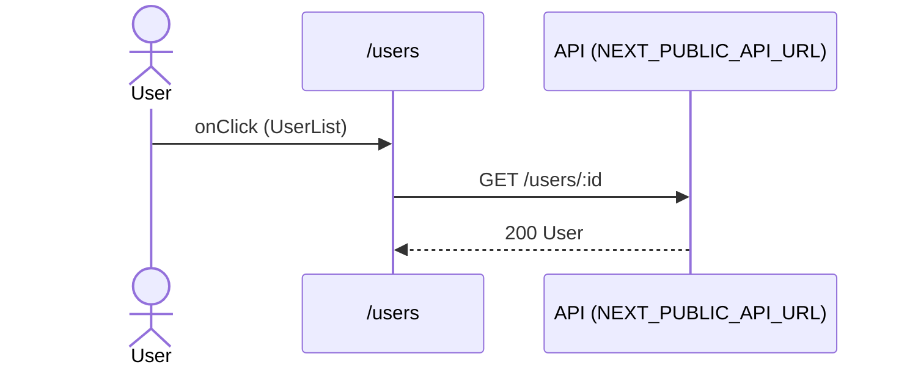

# Flow: UserList click

[← Overview](../README.md)

|  |  |
| --- | --- |
| Starts | [`UserList`](../components/UserList.md) on [`/users`](../pages/users.md) |
| Pages | [`/users`](../pages/users.md) |
| Status | not walked yet |

## Sequence



## Steps

| # | Step | Detail |
| ---: | --- | --- |
| 1 | User `onClick` in [`UserList`](../components/UserList.md) on [`/users`](../pages/users.md) | `src/components/UserList.tsx:30` |
| 2 | [`GET {NEXT_PUBLIC_API_URL ?? http://localhost:4010}/users/:id`](#req_0ka937821vy) | response `User` · ✓ verified (1 capture) |

## Requests

### <a id="req_0ka937821vy"></a>`GET {NEXT_PUBLIC_API_URL ?? http://localhost:4010}/users/:id`

|  |  |
| --- | --- |
| Status | ✓ verified (1 capture) |
| From | [`UserList`](../components/UserList.md) · `src/components/UserList.tsx:18` |
| Trigger | event onClick |
| Transport | fetch · `ensureQueryData(userKeys.detail(id))` · key `['users', :id]` |
| URL | `{NEXT_PUBLIC_API_URL ?? http://localhost:4010}/users/:id` (pattern) |
| Call path | `queryClient.ensureQueryData` → `fetchUser` → `http` → `fetch` |

**Response** [`User`](../types.md#typ_25sov0zzv45)

```ts
{ id: number; name: string; email: string; role: "admin" | "member" }
```

**Captured** `GET http://localhost:4010/users/2` → 200 OK · 4 ms · 2026-10-30 01:38 UTC · page `/users`

Response body:

```json
{
  "id": 2,
  "name": "Alan Turing",
  "email": "alan@example.com",
  "role": "member"
}
```
