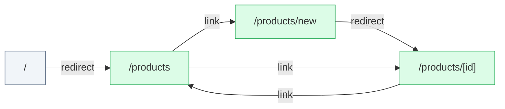

# server-actions: flow map

Generated by flow-checker v0.0.0-test on 2026-10-29 12:00 UTC from a scan of `src/app` (Next.js 16.4.3).

> Captured requests in these docs are redacted: passwords, tokens and other sensitive values are masked.

## Summary

|  | Count |
| --- | ---: |
| Pages | 4 |
| Route handlers | 0 |
| Components | 7 |
| Requests | 6 |
| Endpoints | [6](endpoints.md) |
| Flows | 2 |
| Types | 3 |

## Verification

- **6 of 6 requests verified** by live capture (100%).
- 9 captures: 9 matched, 0 ambiguous, 0 unmatched.
- Flows: 0 confirmed, 0 partly walked, 2 not walked yet.

[2 open issues](issues.md). [All types](types.md).

## Route map

Green: every request verified. Red: a type mismatch. Amber: needs a re-check. Grey: not verified yet. Dotted: calls a route handler.

## Pages

| Page | File | Requests | Status |
| --- | --- | --- | --- |
| [`/`](pages/index.md) | `src/app/page.tsx` | 0 | — |
| [`/products`](pages/products.md) | `src/app/products/page.tsx` | 2 | ✓ 2 verified |
| [`/products/[id]`](pages/products.%5Bid%5D.md) | `src/app/products/[id]/page.tsx` | 1 | ✓ 1 verified |
| [`/products/new`](pages/products.new.md) | `src/app/products/new/page.tsx` | 1 | ✓ 1 verified |

## Backends

| Host | Endpoints | Called from the browser |
| --- | ---: | ---: |
| [This app's API](endpoints.md#host-app) | 2 | 2 |
| [`{API_URL ?? http://localhost:4010}`](endpoints.md#host-env_API_URL) | 4 | 0 |

## Flows

| Flow | Pages | Status |
| --- | --- | --- |
| [CreateProductForm submit](flows/createproductform-submit.md) | `/products/new` → `/products/[id]` | not walked yet |
| [DeleteProductButton click](flows/deleteproductbutton-click.md) | `/products` | not walked yet |

## Components

| Component | Kind | File | Requests |
| --- | --- | --- | --- |
| [`RootLayout`](components/RootLayout.md) | server | `src/app/layout.tsx:5` | 0 |
| [`Home`](components/Home.md) | server | `src/app/page.tsx:3` | 0 |
| [`ProductPage`](components/ProductPage.md) | server | `src/app/products/[id]/page.tsx:7` | 1 |
| [`NewProductPage`](components/NewProductPage.md) | server | `src/app/products/new/page.tsx:3` | 0 |
| [`ProductsPage`](components/ProductsPage.md) | server | `src/app/products/page.tsx:7` | 1 |
| [`CreateProductForm`](components/CreateProductForm.md) | client | `src/components/CreateProductForm.tsx:10` | 1 |
| [`DeleteProductButton`](components/DeleteProductButton.md) | client | `src/components/DeleteProductButton.tsx:7` | 1 |
