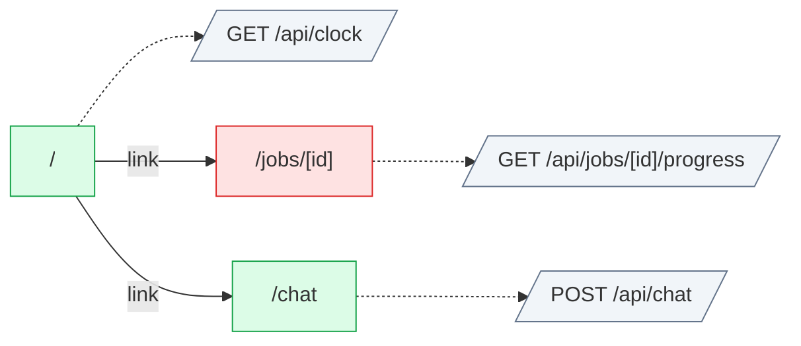

# sse: flow map

Generated by flow-checker v0.0.0-test on 2026-10-29 12:00 UTC from a scan of `app` (Next.js 16.4.3).

> Captured requests in these docs are redacted: passwords, tokens and other sensitive values are masked.

## Summary

|  | Count |
| --- | ---: |
| Pages | 3 |
| Route handlers | 3 |
| Components | 7 |
| Requests | 3 |
| Endpoints | [3](endpoints.md) |
| Flows | 2 |
| Types | 6 |

## Verification

- **3 of 3 requests verified** by live capture (100%).
- 1 request with a type mismatch, 0 requests to re-check after a code change.
- 4 captures: 4 matched, 0 ambiguous, 0 unmatched.
- Flows: 0 confirmed, 0 partly walked, 2 not walked yet.

[3 open issues](issues.md). [All types](types.md).

## Route map

Green: every request verified. Red: a type mismatch. Amber: needs a re-check. Grey: not verified yet. Dotted: calls a route handler.

## Pages

| Page | File | Requests | Status |
| --- | --- | --- | --- |
| [`/`](pages/index.md) | `app/page.tsx` | 1 | ✓ 1 verified |
| [`/chat`](pages/chat.md) | `app/chat/page.tsx` | 1 | ✓ 1 verified |
| [`/jobs/[id]`](pages/jobs.%5Bid%5D.md) | `app/jobs/[id]/page.tsx` | 1 | ✗ 1 mismatch |

## Route handlers

| Route | Methods | File | Requests it sends |
| --- | --- | --- | --- |
| [`/api/chat`](pages/api.chat.md) | POST | `app/api/chat/route.ts` | 0 |
| [`/api/clock`](pages/api.clock.md) | GET | `app/api/clock/route.ts` | 0 |
| [`/api/jobs/[id]/progress`](pages/api.jobs.%5Bid%5D.progress.md) | GET | `app/api/jobs/[id]/progress/route.ts` | 0 |

## Backends

| Host | Endpoints | Called from the browser |
| --- | ---: | ---: |
| [This app's API](endpoints.md#host-app) | 3 | 3 |

## Event streams

| Route handler | Events | Opened by |
| --- | --- | ---: |
| POST [`/api/chat`](pages/api.chat.md) | `chunk`, `done` | 1 |
| GET [`/api/clock`](pages/api.clock.md) | `tick`, `message`, `done` | 1 |
| GET [`/api/jobs/[id]/progress`](pages/api.jobs.%5Bid%5D.progress.md) | `progress`, `done` | 1 |

## Flows

| Flow | Pages | Status |
| --- | --- | --- |
| [Chat submit](flows/chat-submit.md) | `/chat` | not walked yet |
| [JobProgress click](flows/jobprogress-click.md) | `/jobs/[id]` | not walked yet |

## Components

| Component | Kind | File | Requests |
| --- | --- | --- | --- |
| [`ChatPage`](components/ChatPage.md) | server | `app/chat/page.tsx:3` | 0 |
| [`JobPage`](components/JobPage.md) | server | `app/jobs/[id]/page.tsx:3` | 0 |
| [`RootLayout`](components/RootLayout.md) | server | `app/layout.tsx:5` | 0 |
| [`HomePage`](components/HomePage.md) | server | `app/page.tsx:4` | 0 |
| [`Chat`](components/Chat.md) | client | `components/Chat.tsx:7` | 1 |
| [`Clock`](components/Clock.md) | client | `components/Clock.tsx:7` | 1 |
| [`JobProgress`](components/JobProgress.md) | client | `components/JobProgress.tsx:7` | 1 |
