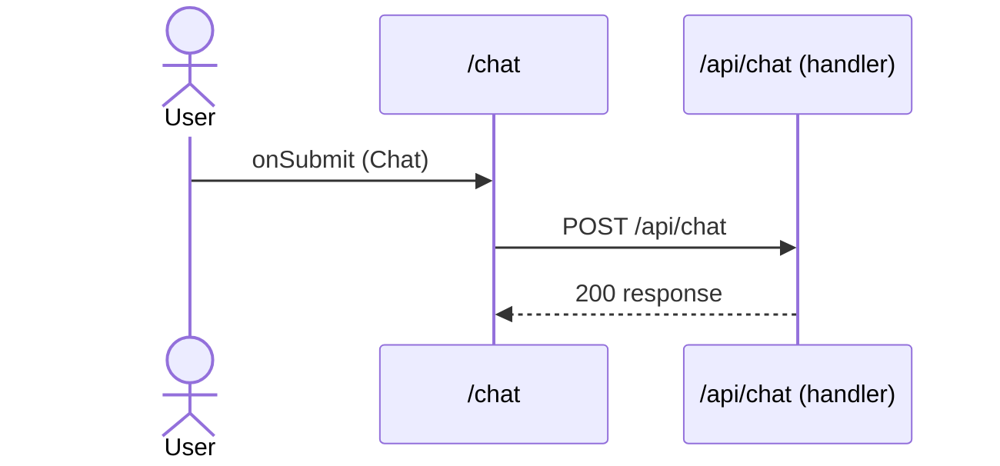

# Flow: Chat submit

[← Overview](../README.md)

|  |  |
| --- | --- |
| Starts | [`Chat`](../components/Chat.md) on [`/chat`](../pages/chat.md) |
| Pages | [`/chat`](../pages/chat.md) |
| Status | not walked yet |

## Sequence



## Steps

| # | Step | Detail |
| ---: | --- | --- |
| 1 | User `onSubmit` in [`Chat`](../components/Chat.md) on [`/chat`](../pages/chat.md) | `components/Chat.tsx:19` |
| 2 | [`POST /api/chat`](#req_09bcv599usy) | body `ChatRequest` · ✓ verified (1 capture) |

## Requests

### <a id="req_09bcv599usy"></a>`POST /api/chat`

|  |  |
| --- | --- |
| Status | ✓ verified (1 capture) |
| From | [`Chat`](../components/Chat.md) · `components/Chat.tsx:15` |
| Trigger | event onSubmit |
| Transport | sse |
| URL | `/api/chat` |
| Handled by | [`/api/chat`](../pages/api.chat.md) |
| Stream | streamed fetch |
| Call path | `streamChat` → `fetch` |

**Request body** [`ChatRequest`](../types.md#typ_04sa5nuyyt9)

```ts
{ prompt: string }
```

**Event `chunk`** (type from the route handler) [`ChatChunk`](../types.md#typ_0xbzrh9hnrs)

```ts
{ delta: string }
```

**Event `done`** (type from the route handler) [`ChatDone`](../types.md#typ_18qlraimf3z)

```ts
{ tokens: number }
```

**Captured** `POST http://localhost:3077/api/chat` → 200 OK · 483 ms · 2026-10-30 12:50 UTC · page `/chat`

Request body:

```json
{
  "prompt": "hello there"
}
```

Messages: 5 received, closed

```text
chunk: {"delta":"You "}
chunk: {"delta":"said: "}
chunk: {"delta":"hello "}
chunk: {"delta":"there "}
done: {"tokens":4}
```
