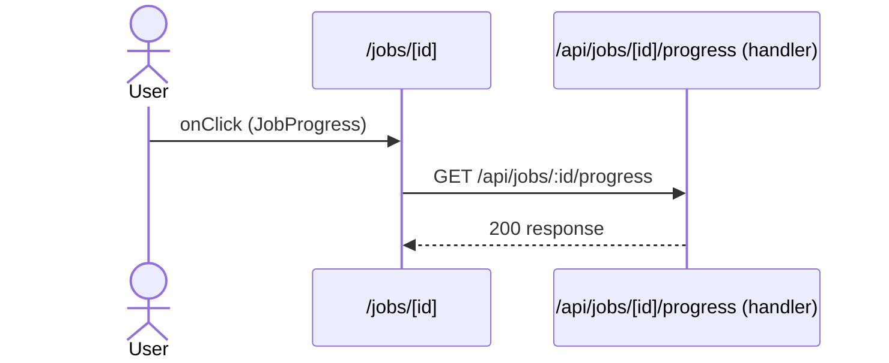

# Flow: JobProgress click

[← Overview](../README.md)

|  |  |
| --- | --- |
| Starts | [`JobProgress`](../components/JobProgress.md) on [`/jobs/[id]`](../pages/jobs.%5Bid%5D.md) |
| Pages | [`/jobs/[id]`](../pages/jobs.%5Bid%5D.md) |
| Status | not walked yet |

## Sequence



## Steps

| # | Step | Detail |
| ---: | --- | --- |
| 1 | User `onClick` in [`JobProgress`](../components/JobProgress.md) on [`/jobs/[id]`](../pages/jobs.%5Bid%5D.md) | `components/JobProgress.tsx:27` |
| 2 | [`GET /api/jobs/:id/progress`](#req_2efgv3zloxh) | ✗ type mismatch (1 capture) |

## Requests

### <a id="req_2efgv3zloxh"></a>`GET /api/jobs/:id/progress`

|  |  |
| --- | --- |
| Status | ✗ type mismatch (1 capture) |
| From | [`JobProgress`](../components/JobProgress.md) · `components/JobProgress.tsx:17` |
| Trigger | event onClick |
| Transport | sse |
| URL | `/api/jobs/:id/progress` (pattern) |
| Handled by | [`/api/jobs/[id]/progress`](../pages/api.jobs.%5Bid%5D.progress.md) |
| Stream | EventSource |

> ⚠ **type-mismatch**: Event "progress" doesn't match Progress: percent is string "25%" (expected number) (1 of 1 capture).

**Event `progress`** [`Progress`](../types.md#typ_17hog64q8p8)

```ts
{ percent: number; step: string }
```

**Event `done`** (type from the route handler) `{ id: string; token: string; }`

```ts
{ id: string; token: string }
```

**Type check**: 1 of 1 checked capture didn't match.

| Part | Field | Problem | Expected | Captured | Captures |
| --- | --- | --- | --- | --- | ---: |
| event `progress` | `percent` | wrong-type | `number` | `string "25%"` | 1 |

**Captured** `GET http://localhost:3077/api/jobs/7/progress` → 200 · 2349 ms · 2026-10-30 12:50 UTC · page `/jobs/7`

Messages: 5 received, closed

```text
progress: {"percent":"25%","step":"queued"}
progress: {"percent":"50%","step":"building"}
progress: {"percent":"75%","step":"testing"}
progress: {"percent":"100%","step":"deploying"}
done: {"id":"7","token":"[REDACTED:string]"}
```

Masked: `messages[4].body.token`
