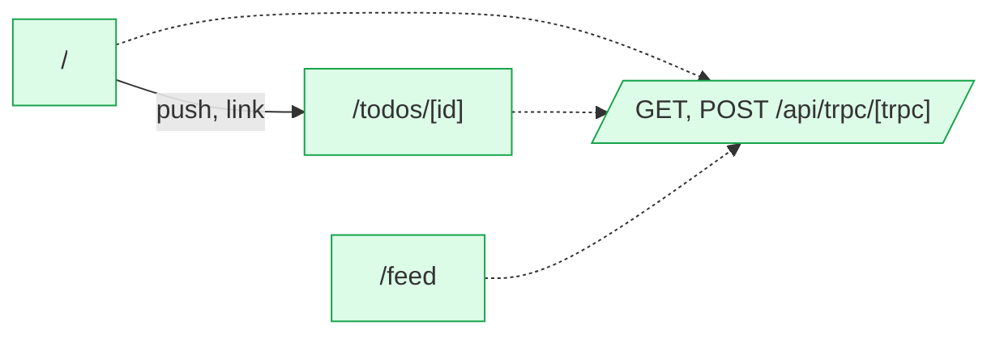

# trpc-v10: flow map

New to this app? [Start here](ONBOARDING.md) for a short tour.

Generated by flow-checker v0.0.0-test on 2026-10-29 12:00 UTC from a scan of `src/app` (Next.js 16.4.3).

> Captured requests in these docs are redacted: passwords, tokens and other sensitive values are masked.

## Summary

|  | Count |
| --- | ---: |
| Pages | 3 |
| Areas | [3](areas.md) |
| Route handlers | 1 |
| Components | 11 |
| Requests | 13 |
| Endpoints | [12](endpoints.md) |
| Flows | 2 |
| Types | 3 |

## Verification

- **13 of 13 requests verified** by live capture (100%).
- 19 captures: 19 matched, 0 ambiguous, 0 unmatched.
- Flows: 0 confirmed, 0 partly walked, 2 not walked yet.

[2 open issues](issues.md). [All types](types.md).

## Route map

Green: every request verified. Red: a type mismatch. Amber: needs a re-check. Grey: not verified yet. Dotted: calls a route handler.

## Pages

| Page | File | Access | Requests | Status |
| --- | --- | --- | --- | --- |
| [`/`](pages/index.md) | `src/app/page.tsx` | open | 4 | ✓ 4 verified |
| [`/feed`](pages/feed.md) | `src/app/feed/page.tsx` | open | 1 | ✓ 1 verified |
| [`/todos/[id]`](pages/todos.%5Bid%5D.md) | `src/app/todos/[id]/page.tsx` | open | 2 | ✓ 2 verified |

## Areas

| Area | Pages | Flows | Endpoints |
| --- | ---: | ---: | ---: |
| [home](areas.md#ar_1vn39fso9m3) | 1 | 1 | 9 |
| [feed](areas.md#ar_005q5nhjyp9) | 1 | 0 | 4 |
| [todos](areas.md#ar_1zap1ick15k) | 1 | 1 | 7 |

## Route handlers

| Route | Methods | File | Requests it sends |
| --- | --- | --- | --- |
| [`/api/trpc/[trpc]`](pages/api.trpc.%5Btrpc%5D.md) | GET, POST | `src/app/api/trpc/[trpc]/route.ts` | 6 |

## Backends

| Host | Endpoints | Called from the browser |
| --- | ---: | ---: |
| [This app's API](endpoints.md#host-app) | 7 | 7 |
| [`{API_URL ?? http://localhost:4010}`](endpoints.md#host-env_API_URL) | 5 | 0 |

## tRPC

[`/api/trpc`](trpc.md): 7 of 7 procedures called by the app.

## Flows

| Flow | Pages | Status |
| --- | --- | --- |
| [AddTodoForm submit](flows/addtodoform-submit.md) | `/` → `/todos/[id]` | not walked yet |
| [TodoDetail click](flows/tododetail-click.md) | `/todos/[id]` | not walked yet |

## Components

| Component | Kind | File | Requests |
| --- | --- | --- | --- |
| [`FeedPage`](components/FeedPage.md) | server | `src/app/feed/page.tsx:3` | 0 |
| [`RootLayout`](components/RootLayout.md) | server | `src/app/layout.tsx:6` | 0 |
| [`HomePage`](components/HomePage.md) | server | `src/app/page.tsx:6` | 0 |
| [`Providers`](components/Providers.md) | client | `src/app/providers.tsx:8` | 0 |
| [`TodoPage`](components/TodoPage.md) | server | `src/app/todos/[id]/page.tsx:3` | 0 |
| [`AddTodoForm`](components/AddTodoForm.md) | client | `src/components/AddTodoForm.tsx:7` | 1 |
| [`HealthBadge`](components/HealthBadge.md) | client | `src/components/HealthBadge.tsx:5` | 1 |
| [`TodoDetail`](components/TodoDetail.md) | client | `src/components/TodoDetail.tsx:5` | 2 |
| [`TodoFeed`](components/TodoFeed.md) | client | `src/components/TodoFeed.tsx:5` | 1 |
| [`TodoList`](components/TodoList.md) | client | `src/components/TodoList.tsx:6` | 1 |
| [`UserList`](components/UserList.md) | client | `src/components/UserList.tsx:5` | 1 |
