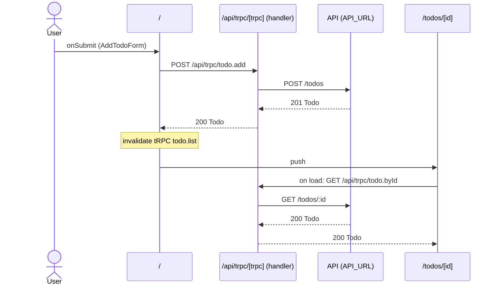

# Flow: AddTodoForm submit

[← Overview](../README.md)

|  |  |
| --- | --- |
| Starts | [`AddTodoForm`](../components/AddTodoForm.md) on [`/`](../pages/index.md) |
| Pages | [`/`](../pages/index.md) → [`/todos/[id]`](../pages/todos.%5Bid%5D.md) |
| Status | not walked yet |

## Sequence



## Steps

| # | Step | Detail |
| ---: | --- | --- |
| 1 | User `onSubmit` in [`AddTodoForm`](../components/AddTodoForm.md) on [`/`](../pages/index.md) | `src/components/AddTodoForm.tsx:24` |
| 2 | [`POST /api/trpc/todo.add`](#req_0sfrr3m6hv2) | body `z.input<typeof NewTodoSchema>` · response `Todo` · ✓ verified (1 capture) |
| 3 | `invalidate` `tRPC todo.list` | refetches `GET /api/trpc/todo.list` · `src/components/AddTodoForm.tsx:13` |
| 4 | push → [`/todos/[id]`](../pages/todos.%5Bid%5D.md) | on success · `src/components/AddTodoForm.tsx:14` |
| 5 | Page loads: [`GET /api/trpc/todo.byId`](#req_0i7plnzsuv7) | body `{ id: number }` · response `Todo` · ✓ verified (2 captures) |

## Requests

### <a id="req_0sfrr3m6hv2"></a>`POST /api/trpc/todo.add`

|  |  |
| --- | --- |
| Status | ✓ verified (1 capture) |
| From | [`AddTodoForm`](../components/AddTodoForm.md) · `src/components/AddTodoForm.tsx:11` |
| Trigger | event onSubmit |
| Transport | trpc · `useMutation` |
| URL | `/api/trpc/todo.add` |
| tRPC | [`todo.add`](../trpc.md#procedure-todo_add) (mutation) |
| Handled by | [`/api/trpc/[trpc]`](../pages/api.trpc.%5Btrpc%5D.md) |

**Request body** `z.input<typeof NewTodoSchema>`

```ts
{ title: string }
```

**Response** [`Todo`](../types.md#typ_0fc96ucq8sd)

```ts
{ id: number; userId: number; title: string; done: boolean }
```

**Captured** `POST http://localhost:3077/api/trpc/todo.add` → 200 · 65 ms · 2026-10-30 07:05 UTC · page `/`

Request body:

```json
{
  "title": "Record captures"
}
```

Response body:

```json
{
  "id": 3,
  "userId": 1,
  "done": false,
  "title": "Record captures"
}
```

**Leads to** `POST {API_URL ?? http://localhost:4010}/todos`:

#### <a id="req_2ah5o8jjwsr"></a>`POST {API_URL ?? http://localhost:4010}/todos`

|  |  |
| --- | --- |
| Status | ✓ verified (1 capture) |
| From | POST [`/api/trpc/[trpc]`](../pages/api.trpc.%5Btrpc%5D.md) · `src/server/routers/todo.ts:20` |
| Trigger | route-handler |
| Transport | fetch |
| URL | `{API_URL ?? http://localhost:4010}/todos` |
| In procedure | [`todo.add`](../trpc.md#procedure-todo_add) (mutation) |
| Call path | `createTodo` → `api` → `fetch` |

**Request body** `{ title: string; userId: number }`

**Response** [`Todo`](../types.md#typ_0fc96ucq8sd)

```ts
{ id: number; userId: number; title: string; done: boolean }
```

**Captured** `POST http://localhost:4010/todos` → 201 Created · 6 ms · 2026-10-30 07:05 UTC

Request body:

```json
{
  "title": "Record captures",
  "userId": 1
}
```

Response body:

```json
{
  "id": 3,
  "userId": 1,
  "done": false,
  "title": "Record captures"
}
```

### <a id="req_0i7plnzsuv7"></a>`GET /api/trpc/todo.byId`

|  |  |
| --- | --- |
| Status | ✓ verified (2 captures) |
| From | [`TodoDetail`](../components/TodoDetail.md) · `src/components/TodoDetail.tsx:7` |
| Trigger | page-load |
| Transport | trpc · `useQuery` |
| URL | `/api/trpc/todo.byId` |
| tRPC | [`todo.byId`](../trpc.md#procedure-todo_byId) (query) |
| Handled by | [`/api/trpc/[trpc]`](../pages/api.trpc.%5Btrpc%5D.md) |

**Request body** `{ id: number }`

**Response** [`Todo`](../types.md#typ_0fc96ucq8sd)

```ts
{ id: number; userId: number; title: string; done: boolean }
```

**Captured** `GET http://localhost:3077/api/trpc/todo.byId` → 200 · 25 ms · 2026-10-30 07:05 UTC · page `/todos/3` (newest of 2)

Request body:

```json
{
  "id": 3
}
```

Response body:

```json
{
  "id": 3,
  "userId": 1,
  "done": true,
  "title": "Record captures"
}
```

**Leads to** `GET {API_URL ?? http://localhost:4010}/todos/:id`:

#### <a id="req_19v0zzhv2k5"></a>`GET {API_URL ?? http://localhost:4010}/todos/:id`

|  |  |
| --- | --- |
| Status | ✓ verified (2 captures) |
| From | GET [`/api/trpc/[trpc]`](../pages/api.trpc.%5Btrpc%5D.md) · `src/server/routers/todo.ts:17` |
| Trigger | route-handler |
| Transport | fetch |
| URL | `{API_URL ?? http://localhost:4010}/todos/:id` (pattern) |
| In procedure | [`todo.byId`](../trpc.md#procedure-todo_byId) (query) |
| Call path | `getTodo` → `api` → `fetch` |

**Response** [`Todo`](../types.md#typ_0fc96ucq8sd)

```ts
{ id: number; userId: number; title: string; done: boolean }
```

**Captured** `GET http://localhost:4010/todos/3` → 200 OK · 2 ms · 2026-10-30 07:05 UTC (newest of 2)

Response body:

```json
{
  "id": 3,
  "userId": 1,
  "done": true,
  "title": "Record captures"
}
```
