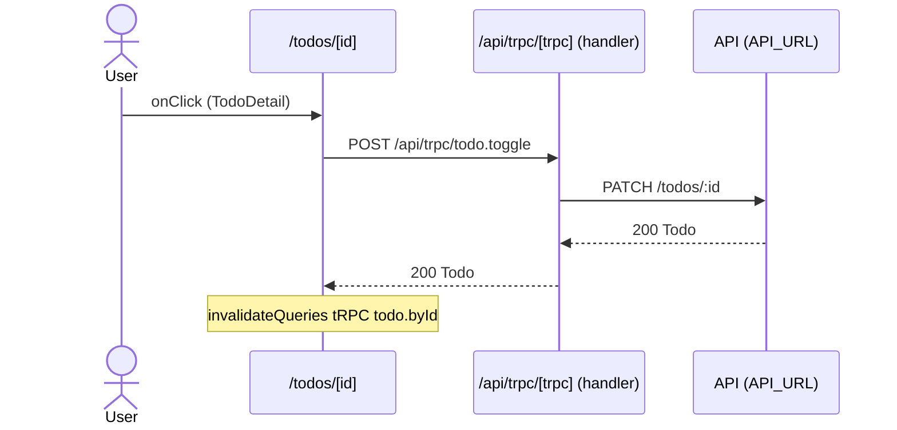

# Flow: TodoDetail click

[← Overview](../README.md)

|  |  |
| --- | --- |
| Starts | [`TodoDetail`](../components/TodoDetail.md) on [`/todos/[id]`](../pages/todos.%5Bid%5D.md) |
| Pages | [`/todos/[id]`](../pages/todos.%5Bid%5D.md) |
| Status | not walked yet |

## Sequence



## Steps

| # | Step | Detail |
| ---: | --- | --- |
| 1 | User `onClick` in [`TodoDetail`](../components/TodoDetail.md) on [`/todos/[id]`](../pages/todos.%5Bid%5D.md) | `src/components/TodoDetail.tsx:27` |
| 2 | [`POST /api/trpc/todo.toggle`](#req_1yefdvziu6b) | body `{ id: number; done: boolean }` · response `Todo` · ✓ verified (1 capture) |
| 3 | `invalidateQueries` `tRPC todo.byId` | refetches `GET /api/trpc/todo.byId` · `src/components/TodoDetail.tsx:19` |

## Requests

### <a id="req_1yefdvziu6b"></a>`POST /api/trpc/todo.toggle`

|  |  |
| --- | --- |
| Status | ✓ verified (1 capture) |
| From | [`TodoDetail`](../components/TodoDetail.md) · `src/components/TodoDetail.tsx:18` |
| Trigger | event onClick |
| Transport | trpc |
| URL | `/api/trpc/todo.toggle` |
| tRPC | [`todo.toggle`](../trpc.md#procedure-todo_toggle) (mutation) |
| Handled by | [`/api/trpc/[trpc]`](../pages/api.trpc.%5Btrpc%5D.md) |

**Request body** `{ id: number; done: boolean }`

**Response** [`Todo`](../types.md#typ_0fc96ucq8sd)

```ts
{ id: number; userId: number; title: string; done: boolean }
```

**Captured** `POST http://localhost:3077/api/trpc/todo.toggle` → 200 · 37 ms · 2026-10-30 07:09 UTC · page `/todos/3`

Request body:

```json
{
  "id": 3,
  "done": true
}
```

Response body:

```json
{
  "id": 3,
  "userId": 1,
  "done": true,
  "title": "Record captures"
}
```

**Leads to** `PATCH {API_URL ?? http://localhost:4010}/todos/:id`:

#### <a id="req_0e790agvf59"></a>`PATCH {API_URL ?? http://localhost:4010}/todos/:id`

|  |  |
| --- | --- |
| Status | ✓ verified (1 capture) |
| From | POST [`/api/trpc/[trpc]`](../pages/api.trpc.%5Btrpc%5D.md) · `src/server/routers/todo.ts:14` |
| Trigger | route-handler |
| Transport | fetch |
| URL | `{API_URL ?? http://localhost:4010}/todos/:id` (pattern) |
| In procedure | [`todo.toggle`](../trpc.md#procedure-todo_toggle) (mutation) |
| Call path | `patchTodo` → `api` → `fetch` |

**Request body** `{ done: boolean; }`

```ts
{ done: boolean }
```

**Response** [`Todo`](../types.md#typ_0fc96ucq8sd)

```ts
{ id: number; userId: number; title: string; done: boolean }
```

**Captured** `PATCH http://localhost:4010/todos/3` → 200 OK · 4 ms · 2026-10-30 07:09 UTC

Request body:

```json
{
  "done": true
}
```

Response body:

```json
{
  "id": 3,
  "userId": 1,
  "done": true,
  "title": "Record captures"
}
```
