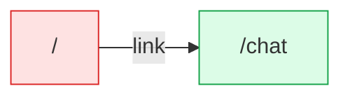

# websocket: flow map

Generated by flow-checker v0.0.0-test on 2026-10-29 12:00 UTC from a scan of `app` (Next.js 16.4.3).

> Captured requests in these docs are redacted: passwords, tokens and other sensitive values are masked.

## Summary

|  | Count |
| --- | ---: |
| Pages | 2 |
| Route handlers | 0 |
| Components | 6 |
| Requests | 3 |
| Flows | 1 |
| Types | 7 |

## Verification

- **3 of 3 requests verified** by live capture (100%).
- 1 request with a type mismatch, 0 requests to re-check after a code change.
- 5 captures: 5 matched, 0 ambiguous, 0 unmatched.
- Flows: 0 confirmed, 0 partly walked, 1 not walked yet.

[2 open issues](issues.md). [All types](types.md).

## Route map

Green: every request verified. Red: a type mismatch. Amber: needs a re-check. Grey: not verified yet. Dotted: calls a route handler.

## Pages

| Page | File | Requests | Status |
| --- | --- | --- | --- |
| [`/`](pages/index.md) | `app/page.tsx` | 2 | ✓ 1 verified, ✗ 1 mismatch |
| [`/chat`](pages/chat.md) | `app/chat/page.tsx` | 1 | ✓ 1 verified |

## WebSockets

| Socket | API | Messages |
| --- | --- | --- |
| [`GET http://localhost:4011/socket.io/`](components/Chat.md#req_1go4wbvvrlb) | socket.io | ↓ `joined`, ↓ `chat`, ↑ `chat` |
| [`GET ws://localhost:4011/echo`](components/Ping.md#req_1pacrdimeqg) | WebSocket | ↑ `message`, ↓ `message` |
| [`GET ws://localhost:4011/live`](components/Ticker.md#req_0utndx9wfnl) | WebSocket | ↑ `message`, ↓ `message` |

## Flows

| Flow | Pages | Status |
| --- | --- | --- |
| [Ping click](flows/ping-click.md) | `/` | not walked yet |

## Components

| Component | Kind | File | Requests |
| --- | --- | --- | --- |
| [`ChatPage`](components/ChatPage.md) | server | `app/chat/page.tsx:3` | 0 |
| [`RootLayout`](components/RootLayout.md) | server | `app/layout.tsx:5` | 0 |
| [`HomePage`](components/HomePage.md) | server | `app/page.tsx:5` | 0 |
| [`Chat`](components/Chat.md) | client | `components/Chat.tsx:9` | 1 |
| [`Ping`](components/Ping.md) | client | `components/Ping.tsx:7` | 1 |
| [`Ticker`](components/Ticker.md) | client | `components/Ticker.tsx:10` | 1 |
