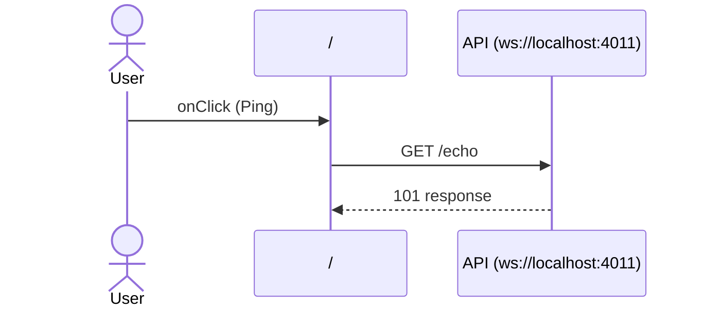

# Flow: Ping click

[← Overview](../README.md)

|  |  |
| --- | --- |
| Starts | [`Ping`](../components/Ping.md) on [`/`](../pages/index.md) |
| Pages | [`/`](../pages/index.md) |
| Status | not walked yet |

## Sequence



## Steps

| # | Step | Detail |
| ---: | --- | --- |
| 1 | User `onClick` in [`Ping`](../components/Ping.md) on [`/`](../pages/index.md) | `components/Ping.tsx:21` |
| 2 | [`GET ws://localhost:4011/echo`](#req_1pacrdimeqg) | ✓ verified (1 capture) |

## Requests

### <a id="req_1pacrdimeqg"></a>`GET ws://localhost:4011/echo`

|  |  |
| --- | --- |
| Status | ✓ verified (1 capture) |
| From | [`Ping`](../components/Ping.md) · `components/Ping.tsx:11` |
| Trigger | event onClick |
| Transport | websocket |
| URL | `ws://localhost:4011/echo` |
| Socket | WebSocket |

**Sends `message`** `"ping"`

**Receives `message`**: no data type.

**Captured** `GET ws://localhost:4011/echo` → 101 · 7 ms · 2026-10-30 14:01 UTC · page `/`

Messages: 2 sent and received, closed, close code 1005

```text
↑ message: ping
↓ message: pong: ping
```
